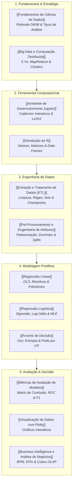

---
aliases:
  - Índice Ciência de Dados
  - MOC Ciência de Dados
  - Início
  - Sumário
tags:
  - moc
  - indice
  - data-science
  - navegacao
---

# 00 - Índice Ciência de Dados (Map of Content)

Bem-vindo à base de conhecimento estruturada e interligada de **Ciência de Dados**. Este repositório reúne, de forma aprofundada e modular, os conceitos teóricos, as formulações matemáticas rigorosas, os códigos práticos na linguagem [[Introdução ao R|R]] e as visualizações interativas em [[Visualização de Dados com Plotly|Plotly]], cobrindo todo o ciclo de vida analítico — desde a coleta bruta até a inteligência estratégica de negócios.

---

## 🗺️ Mapa Visual da Jornada em Ciência de Dados

---

## 📚 Índice Temático Categorizado

### 📌 1. Visão Geral e Conceitos Fundamentais
- **[[Fundamentos de Ciência de Dados]]**  
  *Conceituação ampla da Ciência de Dados; A hierarquia ontológica da pirâmide DIKW (Dado, Informação, Conhecimento e Sabedoria); Diferenças operacionais entre Engenharia de Dados, Business Intelligence e Ciência de Dados; Os quatro níveis analíticos (Descritiva, Diagnóstica, Preditiva e Prescritiva); O ciclo metodológico CRISP-DM e a transição do foco retrospectivo para previsões de futuro.*
- **[[Big Data e Computação Distribuída]]**  
  *A evolução histórica das bases de dados (arquivos planos, bancos relacionais e Big Data); Os 5 Vs de Big Data (Volume, Velocidade, Variedade, Veracidade e Valor); Tabela comparativa exaustiva entre arquiteturas Centralizadas, Replicadas e Distribuídas; O paradigma do MapReduce (fases Map, Shuffle/Sort e Reduce); Estudo de caso clássico completo de identificação de amigos em comum em redes sociais; Governança e Centros de Excelência.*

---

### 💻 2. Ambiente e Linguagens de Programação
- **[[Ambiente de Desenvolvimento Jupyter]]**  
  *Origem do acrônimo (Julia, Python e R) e arquitetura cliente-servidor; Diferença entre Modo de Comando (barra azul) e Modo de Edição (barra verde); Tabela completa de atalhos rápidos essenciais (`a`, `b`, `c`, `v`, `x`, `z`, `m`, `y`, `dd`, `Shift+Enter`); Tipos de células (Código, Markdown e Raw); Sintaxe de documentação científica rica e equações em KaTeX/LaTeX; Instalação e configuração do kernel R (`IRkernel`); Exportação de relatórios em múltiplos formatos e boas práticas de reprodutibilidade.*
- **[[Introdução ao R]]**  
  *História e premissas fundamentais da linguagem (interpretada, tipagem dinâmica/fraca, sensibilidade a maiúsculas/minúsculas, indexação baseada em 1, ausência de tipos primitivos escalares); Sintaxe de atribuição (`<-` vs `=`) e comentários; Tipos atômicos (`numeric`, `integer`, `character`, `logical`) e a hierarquia rígida de coerção; Estruturas de dados essenciais: Vetores (criação, fatiamento, indexação negativa, operações vetorizadas), Fatores nominais e ordinais, Matrizes e multiplicação algébrica matricial (`%*%`), e [[Data Frames]] (criação, filtragem com operador `$`, coordenadas `[i, j]` e seleção lógica); Gerenciamento do workspace (`ls`, `rm`, `save`, `load`).*

---

### 🛠️ 3. Engenharia e Preparação de Dados
- **[[Extração e Tratamento de Dados (ETL)]]**  
  *O papel crítico do pipeline ETL (Extract, Transform, Load) na mitigação do princípio GIGO (Garbage In, Garbage Out); Extração de arquivos tabulares locais (`read.table`, `read.csv`) e descompactação de arquivos `.zip`; Transformação temporal com a família `as.POSIXct` e `strptime`; Tratamento de expressões regulares (`grep`, `gsub`) para expurgo de linhas defeituosas (`[ERRO]`); Diagnóstico e tratamento de dados ausentes (`NA`) via remoção e imputação estatística; Valores sentinelas de hardware (`99.9`) e restrições de domínio físico (umidade $> 100\%$, vento anômalo); Engenharia de atributos físicos (fórmula de Sensação Térmica / Wind Chill); Estudos de caso práticos detalhados: Série temporal meteorológica CEPAGRI/UNICAMP (2017-2022) e Vendas de Imóveis de King County (`kc_house_data`); Carga e persistência compartimentada de checkpoints em `.RData`.*
- **[[Pré-Processamento e Engenharia de Atributos]]**  
  *A importância matemática do pré-processamento para a convergência de modelos; Normalização Min-Max (formulação $x_{\text{norm}} \in [0, 1]$ e sensibilidade extrema a outliers) versus Padronização Z-Score (formulação $z \sim \mathcal{N}(0, 1)$, função `scale` em R); Tabela de sensibilidade de algoritmos à escala; Codificação de variáveis categóricas (One-Hot Encoding / Variáveis Dummy) e a **Armadilha da Variável Dummy (*Dummy Variable Trap*)** com a prova matemática da singularidade de $(\mathbf{X}^T \mathbf{X})$ e a regra estrita de $k-1$ dummies; Engenharia de interações multiplicativas ($X_1 \cdot X_2$) e termos polinomiais ($X^2$) via `I()`; Protocolo de particionamento estratificado reprodutível em conjuntos de Treino (60%), Validação (20%) e Teste (20%) com a função `sample()` e `set.seed()`.*

---

### 🤖 4. Aprendizado de Máquina Supervisionado
- **[[Regressão Linear]]**  
  *Fundamentação teórica da regressão linear simples ($Y_i = \beta_0 + \beta_1 X_i + \epsilon_i$); O método dos Mínimos Quadrados Ordinários (OLS) e a dedução analítica dos estimadores $\hat{\beta}_1$ e $\hat{\beta}_0$; As seis premissas clássicas do Teorema de Gauss-Markov (BLUE); Regressão linear múltipla em notação matricial ($\mathbf{Y} = \mathbf{X}\boldsymbol{\beta} + \boldsymbol{\epsilon}$) e solução analítica $\hat{\boldsymbol{\beta}} = (\mathbf{X}^T \mathbf{X})^{-1} \mathbf{X}^T \mathbf{Y}$; Interpretação dos coeficientes parciais; Métricas de qualidade: $R^2$, $R^2_{\text{adj}}$, $MAE$, $MSE$ e $RMSE$; Diagnóstico gráfico de resíduos e detecção de relações parabólicas curvilíneas (estudo de caso com dataset `women`, demonstrando redução de 94% no MSE ao incluir $\text{altura}^2$); Estudo de caso de regressão múltipla com indicadores socioeconômicos dos estados americanos (`state.x77`) e critérios de informação AIC/BIC.*
- **[[Regressão Logística]]**  
  *O problema da classificação binária e por que o OLS falha (predições fora do intervalo $[0, 1]$, heterocedasticidade intrínseca e erros não normais); A função logística sigmoide $\sigma(z) = \frac{1}{1 + e^{-z}}$; Derivação matemática da Razão de Chances (*Odds Ratio* $= \frac{p}{1-p}$) e da função Logit ($\ln(\text{Odds}) = \mathbf{X}\boldsymbol{\beta}$); Interpretação multiplicativa dos coeficientes na escala de chances via $e^{\beta_j}$; Estimação de parâmetros por Máxima Verossimilhança (MLE) via algoritmos iterativos de Fisher Scoring / Newton-Raphson; Tomada de decisão, regras de corte e calibração do limiar (*cutoff* $\theta$); Estudos de caso práticos completos: Concessão de Empréstimos Bancários (`Simple Loan Dataset`), Potabilidade da Água (`Water Quality Dataset`) e Qualidade de Vinhos (`wine_quality`).*
- **[[Árvores de Decisão]]**  
  *Conceito e arquitetura não paramétrica; Anatomia estrutural: Nó Raiz, Nós Internos/Decisão, Ramos e Folhas Terminais; Medidas matemáticas rigorosas de impureza: Entropia de Shannon ($- \sum p_i \log_2 p_i$), Índice Gini ($1 - \sum p_i^2$) e Erro de Classificação ($1 - \max p_i$); Impureza coletiva dos nós filhos ($I_{\text{split}}$) e Ganho de Informação ($IG$); Partição de atributos binários, categóricos politômicos (1 vs resto) e numéricos contínuos (busca do limiar ótimo de corte); O fenômeno do Sobreajuste (*Overfitting*); Pré-poda (*early stopping* com `minsplit`, `minbucket`, `maxdepth`) versus Pós-poda por complexidade de custo (*cost-complexity pruning* com função $R_\alpha(T) = R(T) + \alpha |T|$); Seleção do melhor `cp` pelo erro de validação cruzada (`plotcp` e `prune`); Árvores ponderadas e Matriz de Perda (*Loss Matrix*) para custos assimétricos de erro (estudos de caso de fraude em seguros e risco de crédito).*
  - **[[Árvore de Decisão - Passo a Passo]]**: *Tutorial completo com gráficos interativos das curvas de impureza, cálculo manual detalhado no exemplo de empréstimo, regra de poda 1-SE e tratamento de desbalanceamento.*
  - **[[Exercício Resolvido em R - Árvore de Decisão Water Quality]]**: *Resolução comentada linha a linha em R do caderno Water Quality: tratamento de NAs, split 70/15/15, `mod_bas`, `mod_pod` (`cp=0.02`), `mod_pes` e avaliação final no teste.*
- **[[Floresta Aleatória - Guia Completo]]**  
  *Aprendizado em conjunto (*Ensemble* / *Bagging*): amostragem bootstrap com reposição, dados Out-Of-Bag (OOB) e seleção aleatória de features (`mtry`); exemplo passo a passo de votação majoritária; ajuste de `mtry` e `ntree` com gráficos interativos no estudo de caso Titanic, imputação estratificada de NAs e importância de variáveis (`varImp`).*

---

### 📊 5. Avaliação de Modelos e Diagnóstico
- **[[Métricas de Avaliação de Modelos]]**  
  *Guia metodológico integrado sobre validação preditiva, validação cruzada, o trade-off entre viés e variância, métricas para problemas contínuos (MAE, MSE, RMSE, R²) e problemas de classificação.*
- **Páginas Aprofundadas de Métricas e Diagnóstico de Classificação:**
  - **[[Matriz de Confusão]]**: *Tabela de contingência fundamental confrontando classes reais versus preditas; Verdadeiro Positivo ($TP$), Falso Positivo ($FP$ — Erro Tipo I), Verdadeiro Negativo ($TN$) e Falso Negativo ($FN$ — Erro Tipo II); Aplicação em problemas binários e multiclasse; Heatmap interativo.*
  - **[[Acurácia]]**: *Proporção global de acertos ($Acc = \frac{TP + TN}{\text{Total}}$); O perigoso Paradoxo da Acurácia em classes desbalanceadas; [[Acurácia|Acurácia Balanceada]] ($Acc_B = \frac{\text{TPR} + \text{TNR}}{2}$).*
  - **[[Precisão]]**: *Valor Preditivo Positivo ($PPV = \frac{TP}{TP + FP}$); Confiabilidade dos disparos afirmativos do modelo; Cenários onde Falsos Positivos têm custo proibitivo (filtros de spam, investimentos de alto risco).*
  - **[[Recall]]**: *Sensibilidade / Revocação / Taxa de Verdadeiros Positivos ($TPR = \frac{TP}{TP + FN}$); Capacidade de cobertura e captura da classe de interesse; Cenários onde Falsos Negativos são críticos (diagnóstico médico, detecção de fraudes).*
  - **[[Especificidade]]**: *Taxa de Verdadeiros Negativos ($TNR = \frac{TN}{TN + FP}$); Taxa de Falsos Positivos ($FPR = 1 - \text{Especificidade}$); Proteção contra alarmes falsos.*
  - **[[F1-Score]]**: *Média harmônica balanceando Precisão e Recall ($F_1 = \frac{2TP}{2TP + FP + FN}$); Justificativa da média harmônica sobre a aritmética; A família paramétrica $F_\beta$-Score ($F_2$ e $F_{0,5}$).*
  - **[[Curva ROC]]**: *Curva Característica de Operação do Receptor; Gráfico dinâmico do trade-off entre TPR ($Recall$) e FPR ($1 - \text{Especificidade}$) através de todos os pontos de corte $\theta \in [0, 1]$; Gráfico interativo em Plotly.*
  - **[[AUC]]**: *Área sob a Curva ROC; Métrica de síntese escalar; Interpretação probabilística de concordância ($P(\hat{p}_{\text{positivo}} > \hat{p}_{\text{negativo}})$); Invariância de limiar e escala.*

---

### 📈 6. Visualização e Comunicação Interativa
- **[[Visualização de Dados com Plotly]]**  
  *Princípios da comunicação visual de dados e a "Gramática dos Gráficos"; Vantagens da interatividade analítica (zoom, pan, hover tooltips); Como funciona o plugin `obsidian-plotly` e a estrutura declarativa de blocos em YAML (`data`, `layout`, `config`); Exemplos interativos embutidos prontos para uso:*
  - *Gráfico de Dispersão com Linha de Regressão Linear Ajustada (altura vs peso);*
  - *Heatmap Interativo da Matriz de Confusão (gradiente térmico em azul);*
  - *Boxplot Comparativo de Distribuição de Variáveis por Classe (escore de crédito);*
  - *Gráfico de Barras Agrupadas para Comparação Simultânea de Métricas entre Modelos Preditivos;*
  *Integração de R com Plotly via `plot_ly()` e `ggplotly()` para conversão de gráficos do `ggplot2`.*

---

### 🏢 7. Negócios, Gestão e Inteligência Corporativa
- **[[Business Intelligence e Análise de Negócios]]**  
  *Definição conceitual de Business Intelligence (BI); Comparativo aprofundado entre BI (passado/presente, dados estruturados, análise descritiva/diagnóstica) e Ciência de Dados (futuro, big data heterogêneo, análise preditiva/prescritiva); Business Performance Management (BPM) e seu ciclo de 4 etapas (Estratégia, Planejamento, Monitoramento, Ajuste); Indicadores-Chave de Desempenho (KPIs) sob a metodologia SMART; O framework do Balanced Scorecard (BSC) e suas 4 perspectivas (Financeira, Clientes, Processos Internos, Aprendizado e Crescimento); Arquitetura tecnológica em camadas de BI: Sistemas transacionais OLTP versus sistemas analíticos OLAP; Modelagem dimensional: Esquema Estrela (*Star Schema*) e Floco de Neve (*Snowflake Schema*); Cubos OLAP e operações analíticas (*Roll-up*, *Drill-down*, *Slice*, *Dice*, *Pivot*); Governança de dados, catálogo corporativo e Centros de Excelência (CoE).*

---

## 🧭 Trilha de Aprendizagem Recomendada

Para um estudo estruturado e progressivo de todo o conteúdo, recomenda-se a seguinte ordem sequencial de leitura:

1. **Contexto & Fundações**:
   - Inicie por [[Fundamentos de Ciência de Dados]] para assimilar a pirâmide DIKW e os tipos de análise.
   - Prossiga para [[Big Data e Computação Distribuída]] para entender a escala massiva de dados e o MapReduce.
2. **Ambiente & Ferramental**:
   - Domine a interface e os atalhos de trabalho em [[Ambiente de Desenvolvimento Jupyter]].
   - Aprenda a programar e manipular dados matriciais em [[Introdução ao R]].
3. **Saneamento & Engenharia**:
   - Pratique a higienização de bases reais e tratamento de erros em [[Extração e Tratamento de Dados (ETL)]].
   - Prepare as variáveis com padronização e variáveis dummy em [[Pré-Processamento e Engenharia de Atributos]].
4. **Modelagem Preditiva**:
   - Compreenda a predição contínua e diagnóstico de resíduos em [[Regressão Linear]].
   - Avance para a classificação probabilística em [[Regressão Logística]].
   - Explore regras não paramétricas e partições hierárquicas em [[Árvores de Decisão]].
5. **Avaliação & Entrega**:
   - Meça a generalização com matrizes de confusão e curvas ROC em [[Métricas de Avaliação de Modelos]].
   - Crie painéis visuais ricos e interativos em [[Visualização de Dados com Plotly]].
   - Conecte seus insights técnicos às metas estratégicas organizacionais em [[Business Intelligence e Análise de Negócios]].

---

### 🎓 6. Preparação para Avaliações e Interpretação Gráfica
- **[[REVISÃO]]**: *Apontamentos pontuais da aula de revisão (foco em resíduos, gráficos, MinMax, One-Hot Encoding e logística).*
- **[[Guia de Interpretação e Leitura de Gráficos]]**: *Manual visual exaustivo contendo de 2 a 6 exemplos interativos de cada tipo de gráfico (Box-plots, Dispersão, Pairplots, Heatmaps de Correlação -1 a 1, Curvas ROC, Sigmoides, Resíduos e Treino vs Teste).*
- **[[Exercícios de Interpretação de Gráficos e Modelos]]**: *Simulado completo com 45 exercícios divididos em Nível Fundamental, Intermediário e Avançado, com seção dedicada de dicas.*
- **[[Resoluções e Gabarito Comentado - Exercícios de Gráficos]]**: *Resoluções analíticas completas passo a passo das 45 questões, com fundamentações teóricas para prova.*
