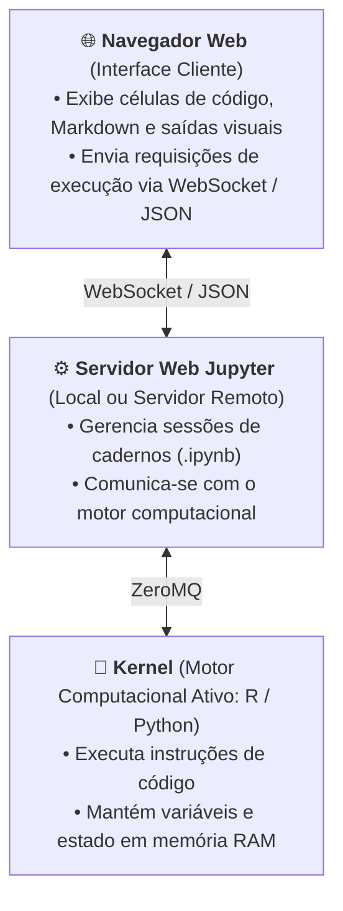

---
aliases:
  - Jupyter
  - Jupyter Notebook
  - JupyterLab
  - Cadernos Jupyter
tags:
  - ferramentas
  - jupyter
  - programacao
  - data-science
---

# Ambiente de Desenvolvimento Jupyter

O ecossistema **Jupyter** é uma das ferramentas computacionais mais populares e indispensáveis em [[Fundamentos de Ciência de Dados]]. Trata-se de uma aplicação web de código aberto que permite criar, executar e compartilhar documentos dinâmicos chamados de **cadernos interativos** (*notebooks*). Esses documentos integram perfeitamente blocos de código executável, visualizações gráficas geradas em tempo real, textos explicativos estruturados em Markdown e fórmulas matemáticas formatadas em LaTeX.

O nome **Jupyter** é uma homenagem às três linguagens pioneiras de computação científica suportadas nativamente pelo projeto: **Ju**lia, **Pyt**hon e **R**, além de referenciar os cadernos astronômicos de Galileu Galilei ao observar as luas de Júpiter.

---

## 1. Arquitetura e Filosofia do Jupyter

A arquitetura do Jupyter opera sob o padrão **cliente-servidor**:



Os arquivos de caderno possuem a extensão `.ipynb` e são serializados internamente no formato padrão **JSON**, estruturados em uma lista ordenada de nós chamados **células**.

---

## 2. Modos de Operação do Caderno

A interface do Jupyter Notebook possui dois modos de interação distintos:

### 2.1. Modo de Comando (*Command Mode*)
- **Identificação Visual**: A margem esquerda da célula selecionada é indicada em **azul** (ou cinza sem cursor de texto ativo).
- **Finalidade**: Executar ações estruturais no documento (inserir, mover, copiar, colar ou excluir células inteiras).
- **Como ativar**: Pressionando a tecla `Esc` em qualquer célula.

### 2.2. Modo de Edição (*Edit Mode*)
- **Identificação Visual**: A margem esquerda da célula selecionada é destacada em **verde** e um cursor de digitação pisca no interior da célula.
- **Finalidade**: Digitar e editar o conteúdo da célula (seja código-fonte ou texto Markdown).
- **Como ativar**: Clicando duas vezes na célula ou selecionando-a e pressionando `Enter`.

---

## 3. Teclas de Atalho Essenciais

O domínio dos atalhos de teclado acelera significativamente a produtividade durante a exploração e limpeza de dados:

| Atalho (Modo de Comando) | Ação Executada |
| :--- | :--- |
| `Enter` | Entra no **Modo de Edição** na célula atual |
| `Esc` | Retorna ao **Modo de Comando** |
| `a` (*above*) | Insere uma nova célula **acima** da célula atual |
| `b` (*below*) | Insere uma nova célula **abaixo** da célula atual |
| `c` | **Copia** a célula selecionada para a área de transferência |
| `x` | **Recorta** a célula selecionada |
| `v` | **Cola** a célula copiada abaixo da célula atual |
| `d + d` (duas vezes) | **Exclui** a célula selecionada |
| `z` | **Desfaz** a última exclusão de célula |
| `m` | Converte o tipo da célula para **Markdown** |
| `y` | Converte o tipo da célula para **Código** (*Code*) |
| `r` | Converte o tipo da célula para texto bruto (**Raw**) |
| `Shift + Enter` | **Executa** a célula atual e move o foco para a próxima |
| `Ctrl + Enter` | **Executa** a célula atual mantendo o foco nela |
| `Alt + Enter` | **Executa** a célula atual e insere uma nova célula vazia abaixo |

---

## 4. Tipos de Células

Um caderno Jupyter pode conter três naturezas de células:

1. **Células de Código (*Code*)**:
   - Contêm comandos executáveis na linguagem do kernel ativo (ex: [[Introdução ao R|R]]).
   - Ao serem executadas, o interpretador processa o código e exibe a saída imediatamente abaixo da célula (tabelas, textos, logs de erro ou gráficos).
2. **Células de Texto (*Markdown*)**:
   - Utilizadas para documentação metodológica, hipóteses científicas, conclusões analíticas e explicações conceituais.
   - Suportam estilização rica com formatação padrão Markdown, tabelas, imagens e equações matemáticas KaTeX/LaTeX.
3. **Células Brutas (*Raw*)**:
   - Mantêm o texto em formato plano sem qualquer processamento ou renderização pelo interpretador, sendo utilizadas principalmente por conversores de terminal como `nbconvert` para inserir instruções diretas a compiladores externos (como LaTeX puro).

---

## 5. Sintaxe Markdown e Notação Matemática para Ciência de Dados

A clareza na documentação de cadernos melhora a reprodutibilidade dos experimentos. A sintaxe a seguir é amplamente utilizada:

### 5.1. Títulos e Hierarquia Estrutural
```markdown
# Título Principal do Capítulo (H1)
## Seção Metodológica (H2)
### Subseção de Análise Descritiva (H3)
#### Detalhe Específico de Algoritmo (H4)
```

### 5.2. Estilização de Texto e Listas
```markdown
*Texto em itálico* ou _itálico_
**Texto em negrito para termos cruciais**
~~Texto tachado~~

- Item não ordenado 1
- Item não ordenado 2
  - Sub-item aninhado

1. Primeiro passo da rotina
2. Segundo passo da rotina
3. Terceiro passo da rotina

- [x] Extração e carga de dados concluída
- [ ] Tratamento de valores faltantes pendente
```

### 5.3. Fórmulas Matemáticas em LaTeX
O Jupyter renderiza expressões matemáticas via KaTeX / MathJax. As fórmulas podem ser declaradas em linha (*inline*) delimitadas por cifrões simples `$ ... $` ou em blocos destacados centralizados por cifrões duplos `$$ ... $$`:

```markdown
A fórmula da distância euclidiana entre dois pontos $p$ e $q$ é:
$$d(p, q) = \sqrt{\sum_{i=1}^{n} (p_i - q_i)^2}$$

O modelo clássico de [[Regressão Linear]] simples é expresso por:
$$Y_i = \beta_0 + \beta_1 X_i + \epsilon_i$$
```

---

## 6. Configuração e Gerenciamento do Kernel R

Para executar códigos em R dentro do ambiente Jupyter, é necessário instalar o kernel especializado **IRkernel**:

### 6.1. Instalação e Registro do Kernel
No console do R (ou RStudio), execute os seguintes comandos:

```r
# Instalação do gerenciador de pacotes e dependências
install.packages("devtools")
devtools::install_github("IRkernel/IRkernel")

# Registro do kernel no sistema para o usuário atual
IRkernel::installspec(user = FALSE)
```

### 6.2. Verificação pelo Terminal
No prompt de comando ou terminal do sistema operacional:

```bash
# Listar todos os kernels instalados e reconhecidos pelo Jupyter
jupyter kernelspec list
```

### 6.3. Dimensionamento de Gráficos em R no Jupyter
Por padrão, os gráficos gerados em R dentro do Jupyter podem ter proporções inadequadas. A biblioteca `repr` permite calibrar o tamanho exato de renderização na saída das células:

```r
# Carregamento da biblioteca de representação gráfica
library(repr)

# Função auxiliar personalizada para dimensionar saídas gráficas
grafdim <- function(largura = 11, altura = 6) {
  options(repr.plot.width = largura, repr.plot.height = altura)
}

# Aplicando dimensões para gráficos de análise exploratória
grafdim(10, 5)
plot(1:10, (1:10)^2, type = "b", col = "blue", main = "Curva Exponencial")
```

---

## 7. Exportação e Compartilhamento de Cadernos

O Jupyter disponibiliza múltiplos formatos para entrega de relatórios analíticos:

- **PDF via LaTeX**: Gera relatórios acadêmicos formatados com qualidade tipográfica de publicação.
- **HTML Estático**: Cria páginas web independentes que podem ser abertas em qualquer navegador, preservando tabelas e gráficos embutidos.
- **Arquivo de Script (`.R` ou `.py`)**: Extrai exclusivamente os blocos executáveis de código, descartando textos e imagens para integração em pipelines automáticos de produção.
- **Markdown (`.md`)**: Converte o caderno para integração em wikis e repositórios como o Obsidian e GitHub.

---

## 8. Boas Práticas no Uso de Cadernos

1. **Reiniciar e Executar Tudo Regularmente**: Antes de publicar ou compartilhar um caderno, utilize a opção *Kernel $\to$ Restart & Run All* para garantir que não existem dependências ocultas de células executadas fora de ordem.
2. **Modularização de Etapas**: Mantenha células curtas e dedicadas a um propósito específico (uma célula para carga, uma para transformação, uma para visualização gráfica).
3. **Persistência de Resultados Intermediários**: Em pipelines longos de [[Extração e Tratamento de Dados (ETL)]], salve marcos em arquivos `.RData` após cada transformação complexa, permitindo recomeçar o trabalho sem reprocessar toda a base de dados.
4. **Visualizações Interativas**: Sempre que possível, utilize recursos modernos como [[Visualização de Dados com Plotly]] para permitir zoom e inspeção detalhada de pontos dispersos e curvas analíticas.
