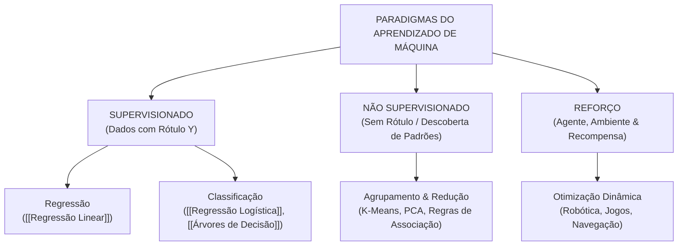
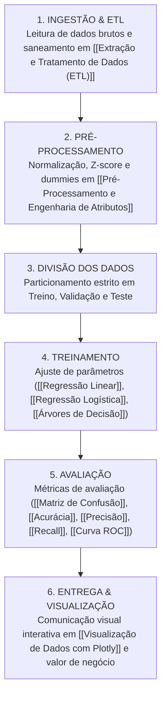

---
aliases:
  - Machine Learning
  - ML
  - Aprendizado Supervisionado
  - Aprendizado Não Supervisionado
tags:
  - machine-learning
  - inteligencia-artificial
  - conceitos
  - data-science
---

# Aprendizado de Máquina (Machine Learning)

O **Aprendizado de Máquina** (*Machine Learning* — ML) é o subcampo da Ciência da Computação e da Inteligência Artificial que desenvolve algoritmos capazes de **aprender regras, padrões matemáticos e relações complexas a partir de dados empíricos históricos**, sem a necessidade de serem explicitamente programados com regras lógicas rígidas e manuais.

Na formulação clássica de Tom Mitchell: *"Um programa de computador aprende a partir da experiência $E$, com relação a uma classe de tarefas $T$ e medida de desempenho $P$, se sua performance nas tarefas de $T$, medida por $P$, melhora com a experiência $E$."*

No ecossistema de [[Fundamentos de Ciência de Dados]], o Machine Learning representa o núcleo preditivo e prescritivo que transforma dados higienizados em inteligência preditiva acionável para o negócio.

---

## 1. Os Três Grandes Paradigmas do Aprendizado de Máquina

A disciplina divide-se em três modalidades principais, de acordo com a natureza dos dados e o tipo de supervisão disponível:

### 1.1. Aprendizado Supervisionado (*Supervised Learning*)
O algoritmo é alimentado com um conjunto de treinamento composto por pares $(X_i, Y_i)$, onde $X_i$ são os atributos preditores (*features*) e $Y_i$ é o rótulo verdadeiro (*target*). O objetivo é aprender uma função hipótese $\hat{Y} = f(X)$ que generalize com precisão para instâncias inéditas:

- **Tarefas de Regressão**: A variável resposta $Y$ é numérica contínua em $\mathbb{R}$.
  - *Modelos Principais*: [[Regressão Linear]] simples e múltipla, modelos polinomiais, regressão com regularização (Ridge e Lasso).
  - *Exemplos*: Previsão do preço de imóveis, estimativa da demanda diária de energia elétrica, projeção de faturamento trimestral.
- **Tarefas de Classificação**: A variável resposta $Y$ é categórica discreta (binária ou multiclasse).
  - *Modelos Principais*: [[Regressão Logística]], [[Árvores de Decisão]], Florestas Aleatórias (*Random Forests*), Máquinas de Vetores de Suporte (*SVM*).
  - *Exemplos*: Diagnóstico de exames médicos, detecção de transações financeiras fraudulentas, aprovação de empréstimos bancários.

---

### 1.2. Aprendizado Não Supervisionado (*Unsupervised Learning*)
O algoritmo recebe apenas os atributos de entrada $X$, sem qualquer rótulo orientador $Y$. O objetivo é descobrir a estrutura subjacente intrínseca, densidades de probabilidade ou agrupamentos naturais dos dados:

- **Agrupamento (*Clustering*)**: Segmentação de clientes por comportamento de consumo (algoritmo K-Means, agrupamento hierárquico);
- **Redução de Dimensionalidade**: Compressão de centenas de variáveis redundantes preservando a variância máxima (Análise de Componentes Principais — PCA);
- **Regras de Associação**: Análise de cesta de compras (*Market Basket Analysis* via algoritmo Apriori).

---

### 1.3. Aprendizado por Reforço (*Reinforcement Learning*)
Um agente autônomo interage ciclicamente com um ambiente dinâmico, executando ações e recebendo recompensas positivas ou penalidades negativas com o objetivo de convergir para uma política ótima de longo prazo.

---

## 2. O Ciclo de Desenvolvimento de Modelos

A construção de soluções robustas de Aprendizado de Máquina segue uma esteira metodológica bem estabelecida:

---

## 3. O Dilema Viés versus Variância (*Bias-Variance Tradeoff*)

Todo modelo de aprendizado supervisionado busca equilibrar duas forças conflitantes:

$$\text{Erro de Generalização} = \text{Viés}^2 + \text{Variância} + \text{Ruído Irredutível}$$

- **Subajuste (*Underfitting* — Alto Viés)**: O algoritmo é simplista demais para capturar a complexidade da realidade empírica (exemplo: ajustar uma reta linear a dados curvilíneos). O modelo erra tanto nos dados de treino quanto no teste.
- **Sobreajuste (*Overfitting* — Alta Variância)**: O algoritmo é excessivamente flexível ou complexo (exemplo: [[Árvores de Decisão]] sem controle de poda), memorizando o ruído e as idiossincrasias da amostra de treino. O modelo atinge erro zero no treino, mas falha gravemente ao prever dados inéditos de teste.

O domínio dos mecanismos de regularização, validação cruzada e poda por parâmetro de complexidade (`cp`) assegura o ponto ótimo de generalização.
