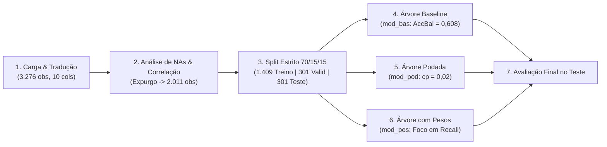

---
aliases:
  - Exercício Water Quality em R
  - Resolução Water Quality Árvore de Decisão
  - Water Quality R Passo a Passo
tags:
  - r
  - exercicio-resolvido
  - water-quality
  - arvores-de-decisao
  - rpart
  - caret
---

# Exercício Resolvido em R: Árvore de Decisão (*Water Quality*)

Este guia resolve e explica **passo a passo em R** o exercício prático do curso sobre potabilidade da água (`03_arvore_decisao_ex_water_quality.ipynb` e `03_arvore_decisao_ex_water_quality__res.ipynb`), detalhando desde o carregamento e limpeza de dados até a modelagem com árvore baseline, poda por complexidade (`cp`), ponderação por pesos e avaliação final.

> [!INFO] Pré-requisitos Conceituais
> Para revisar a teoria matemática por trás de cada função aplicada aqui, consulte [[Árvore de Decisão - Passo a Passo]], [[Extração e Tratamento de Dados (ETL)]] e [[Métricas de Avaliação de Modelos]].

---

## 📌 Visão Geral do Pipeline Executado



---

## Passo 1: Preparação do Ambiente, Carga e Tradução dos Dados

Carregamos as bibliotecas essenciais, configuramos o tamanho padrão dos gráficos no Jupyter (`grafdim`) e lemos o arquivo compactado `Water_Quality.zip` diretamente sem deixar arquivos temporários soltos na pasta.

```r
# Limpeza do workspace e configuração de dígitos
rm(list = ls())
options(digits = 3)

# Bibliotecas de manipulação, visualização e modelagem
library(repr)
library(readr)
library(corrplot)
library(rpart)       # Algoritmo CART de Árvore de Decisão
library(rpart.plot)  # Visualização gráfica das árvores
library(caret)       # Matriz de confusão e métricas de classificação
library(ggplot2)     # Gráficos (heatmap da matriz de confusão)
library(RColorBrewer)

# Função auxiliar para dimensionar gráficos no Jupyter Notebook
grafdim <- function(x = 11, y = 9) {
  options(repr.plot.width = x, repr.plot.height = y)
}
grafdim()

# Descompactando, lendo o CSV e removendo o arquivo extraído temporário
qa <- read.csv(unzip("Water_Quality.zip", "water_potability.csv"))
file.remove("water_potability.csv")

paste("Há", nrow(qa), "registros no conjunto de dados")
# Saída: "Há 3276 registros no conjunto de dados"

# Traduzindo os nomes das colunas para português
names(qa) <- c(
  "ph", "dureza", "solido", "cloramina", "sulfato",
  "condutividade", "carbono_org", "trihalometano", "turbidez", "potavel"
)
str(qa)
```

### Dicionário das Variáveis
* **Preditores contínuos (9 atributos químicos/físicos)**: `ph` ($0$ a $14$), `dureza` (mg/L), `solido` (ppm), `cloramina` (ppm), `sulfato` (mg/L), `condutividade` ($\mu$S/cm), `carbono_org` (ppm), `trihalometano` ($\mu$g/L) e `turbidez` (NTU).
* **Variável resposta (`potavel`)**: `1` = água potável (segura); `0` = água não potável (imprópria).

---

## Passo 2: Diagnóstico de Dados Perdidos (`NA`s) e Correlação

Antes de modelar, inspecionamos onde estão os dados ausentes (`summary(qa)`) e avaliamos se há correlação entre as variáveis que justifique imputação por regressão.

```r
summary(qa)

# Mapeando registros com dados perdidos (NAs)
naph <- is.na(qa$ph)
nasu <- is.na(qa$sulfato)
natr <- is.na(qa$trihalometano)
nall <- naph | nasu | natr
n    <- nrow(qa)

# Checando se há NAs na variável resposta 'potavel'
paste("Há", sum(is.na(qa$potavel)), "dados perdidos (NAs) nas respostas")
# Saída: "Há 0 dados perdidos (NAs) nas respostas"

# Quantificando o impacto dos NAs por classe
paste("Casos com NA:", round(sum(nall) / n * 100, 2), "% (", sum(nall), "em", n, ")")
paste("  Casos positivos com NA:", round(sum(qa$potavel & nall) / n * 100, 2), "% (", sum(qa$potavel & nall), "em", n, ")")
paste("  Casos negativos com NA:", round(sum(qa$potavel == 0 & nall) / n * 100, 2), "% (", sum(qa$potavel == 0 & nall), "em", n, ")")
rm(naph, nasu, natr, nall, n)
```

* **Resultado observado**: Existem **$1.265$ registros com `NA` ($38,61\%$ do total)** — concentrados em `ph`, `sulfato` e `trihalometano`, sendo $467$ positivos ($14,26\%$) e $798$ negativos ($24,36\%$).

Em seguida, checamos a grade de dispersão e a matriz de correlação (ignorando os `NA`s par a par via `"pairwise.complete.obs"`):

```r
# Grade de dispersão colorida pela classe (0 = azul, 1 = vermelho)
grafdim(12, 12)
cores_graf <- ifelse(qa$potavel == 0, "cornflowerblue", "indianred1")
pairs(qa[, 1:9], col = cores_graf, cex = 1.3, cex.labels = 1.7, gap = 0)

# Matriz de correlação de Pearson
correlacao <- cor(qa[, 1:9], use = "pairwise.complete.obs")
corrplot(
  correlacao, method = "number", type = "lower", diag = FALSE,
  tl.cex = 1.4, tl.col = "black", cl.cex = 0.9, number.cex = 1.4
)
```

> [!NOTE] Por que excluímos os `NA`s neste exercício?
> A matriz `corrplot` revelou **correlação praticamente nula** entre todas as 9 variáveis químicas (todas próximas de $0$). Como não é possível prever uma variável faltante a partir das demais e os `NA`s afetam principalmente a classe negativa (que já é majoritária), opta-se inicialmente por remover as linhas incompletas.

```r
# Removendo observações com NA em ph, sulfato ou trihalometano
qan <- qa[!(is.na(qa$ph) | is.na(qa$sulfato) | is.na(qa$trihalometano)), ]

# Conferindo a proporção resultante das classes
npos <- sum(qan$potavel == 1)
nneg <- sum(qan$potavel == 0)
n    <- nrow(qan)

paste("Casos positivos:", round(npos / n * 100, 1), "% (", npos, "em", n, ")")
paste("Casos negativos:", round(nneg / n * 100, 1), "% (", nneg, "em", n, ")")
# Saída: Positivos = 40.3% (811 em 2011) | Negativos = 59.7% (1200 em 2011)
```

---

## Passo 3: Separação em Treino, Validação e Teste + EDA

Dividimos os $2.011$ registros limpos na proporção **$70\%$ Treino ($1.409$)**, **$15\%$ Validação ($301$)** e **$15\%$ Teste ($301$)** com `set.seed(997)` para reprodutibilidade, e verificamos via `merge` que não há vazamento de dados (*data leakage*) entre os conjuntos.

```r
set.seed(997)

taxa_teste  <- 0.15
taxa_valid  <- taxa_teste
taxa_treino <- 1.0 - taxa_teste - taxa_valid

n_teste <- trunc(taxa_teste * nrow(qan))  # 301
n_valid <- trunc(taxa_valid * nrow(qan))  # 301

# Retirada sequencial sem reposição (replace = FALSE)
treino  <- qan

amostra <- sample(1:nrow(treino), n_teste, replace = FALSE)
teste   <- treino[amostra, ]
treino  <- treino[-amostra, ]

amostra <- sample(1:nrow(treino), n_valid, replace = FALSE)
valid   <- treino[amostra, ]
treino  <- treino[-amostra, ]

# Conferência de dimensões: 301, 301 e 1409
nrow(teste); nrow(valid); nrow(treino)

# Prova de interseção zero (0 registros em comum)
nrow(merge(treino, valid, all = FALSE))  # 0
nrow(merge(treino, teste, all = FALSE))  # 0
nrow(merge(valid,  teste, all = FALSE))  # 0
```

### Análise Exploratória Visual (Box-plots e Histogramas)

```r
# Box-plots comparando cada variável química por potabilidade no treino
cores <- c("cornflowerblue", "indianred1")
grafdim(11, 4)
for (i in 1:8) {
  boxplot(
    treino[, i] ~ treino$potavel,
    main = names(treino)[i], horizontal = TRUE, col = cores,
    cex.lab = 1.3, xlab = names(treino)[i], ylab = "potável"
  )
}

# Histogramas das distribuições
nomes <- names(qan)[-10]
grafdim(11, 6)
for (i in nomes) {
  hist(
    qan[, i], col = "moccasin", main = paste("Histograma de", i),
    ylab = "frequência", xlab = i, cex.lab = 1.3
  )
}
```

> [!TIP] O que os gráficos exploratórios mostram?
> Os box-plots das classes `0` e `1` apresentam medianas muito próximas e forte sobreposição em praticamente todas as variáveis químicas isoladas — indicando que nenhum atributo sozinho separa água potável de não potável de forma linear simples, exigindo combinações não lineares (interações de múltiplas variáveis que a árvore busca capturar).

---

## Passo 4: Modelo 1 — Árvore Baseline (`mod_bas`)

Construímos o modelo padrão-base (`mod_bas`) usando `rpart()` com os parâmetros padrão (`minsplit = 20`, `minbucket = 7`, `maxdepth = 30`). Ele servirá de régua para avaliar se podas ou pesos melhoram o desempenho.

```r
# Treinamento da árvore baseline
mod_bas <- rpart(
  potavel ~ .,
  data = treino,
  method = "class",
  minsplit = 20, minbucket = 7, maxdepth = 30
)

# Inspeção da tabela de complexidade e importância de atributos
printcp(mod_bas)
print(mod_bas$variable.importance)

# Plotando a árvore
grafdim(12, 11)
rpart.plot(mod_bas)
```

### Importância das Variáveis Observada (`mod_bas`)
As variáveis efetivamente usadas nos nós da árvore foram `cloramina`, `dureza`, `ph`, `solido` e `sulfato`, com destaque absoluto para `ph`:

```plotly
data:
  - y: ['carbono_org', 'trihalometano', 'condutividade', 'turbidez', 'cloramina', 'sulfato', 'dureza', 'solido', 'ph']
    x: [0.448, 1.843, 1.945, 1.984, 6.820, 23.549, 23.558, 23.991, 49.744]
    type: bar
    orientation: 'h'
    marker:
      color: ['#c6dbef', '#c6dbef', '#c6dbef', '#c6dbef', '#6baed6', '#3182bd', '#3182bd', '#3182bd', '#08519c']
layout:
  title: 'Importância das Variáveis no Modelo Baseline (mod_bas)'
  xaxis:
    title: 'Redução Total de Impureza (Gini)'
  yaxis:
    title: 'Atributo Químico'
```

### Avaliação no Treino e na Validação (`mod_bas`)

```r
# Avaliação no TREINO
predito <- predict(mod_bas, treino, type = "class")
(mat_confus <- confusionMatrix(data = predito, reference = factor(treino$potavel), positive = "1"))
(mod_bas_treino_acbal <- mat_confus$byClass["Balanced Accuracy"])
# Balanced Accuracy (Treino) = 0.667 | Accuracy = 0.713 | Sensitivity = 0.432 | Specificity = 0.901

# Gráfico Heatmap da Matriz de Confusão em R
tabela <- as.data.frame(mat_confus$table)
tabela$Reference <- factor(tabela$Reference, levels = rev(levels(tabela$Reference)))
grafdim(5, 4)
ggplot(tabela, aes(Reference, Prediction, fill = Freq)) +
  geom_tile() + geom_text(aes(label = Freq)) +
  scale_fill_gradient(low = "white", high = "#009194") +
  labs(x = "Reference", y = "Prediction")

# Avaliação na VALIDAÇÃO
predito <- predict(mod_bas, newdata = valid, type = "class")
(mat_confus <- confusionMatrix(data = predito, reference = factor(valid$potavel), positive = "1"))
(mod_bas_valid_acbal <- mat_confus$byClass["Balanced Accuracy"])
# Balanced Accuracy (Validação) = 0.608 | Accuracy = 0.668 | Sensitivity = 0.357 | Specificity = 0.860
```

* **Diagnóstico do `mod_bas`**: A queda da Acurácia Balanceada de **$0,667$ (treino)** para **$0,608$ (validação)** mostra um leve *overfitting*. Além disso, a **Sensibilidade (Recall da classe `1`) é baixa ($35,7\%$)** — o modelo erra 74 das 115 amostras potáveis na validação porque a classe `0` (59,7%) domina as folhas.

---

## Passo 5: Modelo 2 — Árvore Podada (`mod_pod`)

Para combater o *overfitting* do modelo completo, ajustamos `mod_arv` e analisamos o `printcp()` e `plotcp()` para aplicar a **poda por complexidade de custo** (`prune`).

```r
mod_arv <- rpart(potavel ~ ., data = treino, method = "class")
printcp(mod_arv)

grafdim(10, 9)
plotcp(mod_arv, cex.lab = 1.4, cex.axis = 1.2)
```

### Tabela de Complexidade (`printcp`) Real do Exercício:

| Nível | `CP` | `nsplit` (Divisões) | `rel error` (Treino) | `xerror` (Validação Cruzada) | `xstd` |
| :---: | :---: | :---: | :---: | :---: | :---: |
| 1 | `0.04` | 0 | $1,00$ | $1,00$ | $0,03$ |
| 2 | `0.04` | 1 | $1,00$ | $1,00$ | $0,03$ |
| **3** | **`0.02`** | **3** | **$0,90$** | **$0,90$** | **$0,03$** |
| 4 | `0.01` | 11 | $0,70$ | $0,90$ | $0,03$ |
| 5 | `0.01` | 13 | $0,70$ | $0,90$ | $0,03$ |

```plotly
data:
  - x: [0, 1, 3, 11, 13]
    y: [1.0, 1.0, 0.9, 0.9, 0.9]
    type: scatter
    mode: lines+markers
    name: 'Erro de Validação Cruzada (xerror)'
    line:
      color: '#1f77b4'
      width: 3
    marker:
      size: 9
  - x: [0, 13]
    y: [0.93, 0.93]
    type: scatter
    mode: lines
    name: 'Limiar Regra 1-SE (0.90 + 0.03 = 0.93)'
    line:
      color: '#d62728'
      dash: dash
      width: 2
  - x: [3]
    y: [0.9]
    type: scatter
    mode: markers+text
    name: 'Poda Escolhida (3 splits, CP = 0.02)'
    text: ['Nível 3 (CP = 0.02)']
    textposition: 'bottom right'
    marker:
      color: '#2ca02c'
      size: 13
      symbol: 'star'
layout:
  title: 'Curva CP vs xerror no Water Quality (Regra 1-SE)'
  xaxis:
    title: 'Número de Divisões (nsplit)'
  yaxis:
    title: 'Erro Relativo de Validação Cruzada (xerror)'
    range: [0.85, 1.05]
```

Seguindo a **Regra de 1 Erro-Padrão**: menor `xerror` ($0,90$) $+$ `xstd` ($0,03$) $= 0,93$. A menor árvore abaixo desse limiar é a do **nível 3 (`nsplit = 3`, `CP = 0,02`)**.

```r
# Aplicando a poda e avaliando
mod_pod <- prune(mod_arv, cp = 0.02)

grafdim(12, 11)
rpart.plot(mod_pod)

# Avaliação no TREINO
predito <- predict(mod_pod, treino, type = "class")
(mat_confus <- confusionMatrix(data = predito, reference = factor(treino$potavel), positive = "1"))
(mod_pod_treino_acbal <- mat_confus$byClass["Balanced Accuracy"])
# Balanced Accuracy (Treino) = 0.569 | Accuracy = 0.644 | Sensitivity = 0.176 | Specificity = 0.961

# Avaliação na VALIDAÇÃO
predito <- predict(mod_pod, newdata = valid, type = "class")
(mat_confus <- confusionMatrix(data = predito, reference = factor(valid$potavel), positive = "1"))
(mod_pod_valid_acbal <- mat_confus$byClass["Balanced Accuracy"])
# Balanced Accuracy (Validação) = 0.561 | Accuracy = 0.654 | Sensitivity = 0.165 | Specificity = 0.957
```

> [!WARNING] Análise Crítica da Poda (`mod_pod`)
> Embora a poda tenha eliminado a diferença entre treino ($0,569$) e validação ($0,561$), uma árvore com apenas 3 divisões ficou **simples demais (*Underfitting*)**: a Sensibilidade caiu para míseros **$16,5\%$** (quase só prevê `0`!). Isso ocorre porque o problema químico da água exige regras mais profundas para capturar as fronteiras da classe minoritária.

---

## Passo 6: Modelo 3 — Árvore com Ponderação / Pesos (`mod_pes`)

Como os casos potáveis representam apenas $40,2\%$ do treino ($567$ vs $842$), aplicamos **pesos inversamente proporcionais** às frequências das classes para dar maior importância à detecção de positivos (`1`):

```r
# Calculando os pesos de cada classe
npos <- sum(treino$potavel == 1)  # 567
nneg <- sum(treino$potavel == 0)  # 842
n    <- npos + nneg               # 1409

ppos <- nneg / n                  # Peso da classe 1 = 0.598 (proporção da classe 0)
pneg <- npos / n                  # Peso da classe 0 = 0.402 (proporção da classe 1)

# Vetor de pesos alinhado a cada linha do treino
pesos <- ifelse(treino$potavel == 0, pneg, ppos)

# Treinando a árvore ponderada
mod_pes <- rpart(
  potavel ~ .,
  data = treino,
  method = "class",
  weights = pesos,
  minsplit = 20, minbucket = 7, maxdepth = 30
)

printcp(mod_pes)
print(mod_pes$variable.importance)
rpart.plot(mod_pes)

# Avaliação no TREINO
predito <- predict(mod_pes, treino, type = "class")
(mat_confus <- confusionMatrix(data = predito, reference = factor(treino$potavel), positive = "1"))
(mod_pes_treino_acbal <- mat_confus$byClass["Balanced Accuracy"])
# Balanced Accuracy (Treino) = 0.700 | Accuracy = 0.705 | Sensitivity = 0.677 | Specificity = 0.723

# Avaliação na VALIDAÇÃO
predito <- predict(mod_pes, newdata = valid, type = "class")
(mat_confus <- confusionMatrix(data = predito, reference = factor(valid$potavel), positive = "1"))
(mod_pes_valid_acbal <- mat_confus$byClass["Balanced Accuracy"])
# Balanced Accuracy (Validação) = 0.575 | Accuracy = 0.588 | Sensitivity = 0.522 | Specificity = 0.629
```

* **O que mudou com os pesos?** A Sensibilidade na validação saltou de $16,5\%$ (`mod_pod`) e $35,7\%$ (`mod_bas`) para **$52,2\%$**! A contrapartida (*trade-off*) foi a queda na Especificidade (de $86,0\%$ para $62,9\%$), pois o modelo passou a arriscar mais classificações positivas, elevando os Falsos Positivos.

---

## Passo 7: Comparativo Geral e Avaliação Final no Conjunto de Teste

### Tabela Comparativa de Todos os Modelos (Resultados do Material)

| Modelo | Acurácia Balanceada (Treino) | Acurácia Balanceada (Validação) | Sensibilidade (Validação) | Especificidade (Validação) | Diagnóstico |
| :--- | :---: | :---: | :---: | :---: | :--- |
| **`mod_bas` (Baseline Completo)** | $0,667$ | **$0,608$** 🏆 | $0,357$ | $0,860$ | Melhor acurácia balanceada global na validação, mas baixo Recall de potáveis. |
| **`mod_pod` (Podado `cp=0.02`)** | $0,569$ | $0,561$ | $0,165$ | $0,957$ | *Underfitting*: muito conservador, chuta quase tudo como não potável (`0`). |
| **`mod_pes` (Ponderado)** | $0,700$ | $0,575$ | **$0,522$** | $0,629$ | Maior equilíbrio entre classes (maior Recall), porém sofre mais *overfitting* (0,700 $\to$ 0,575). |

### ⚠️ Alerta Crítico de Negócio (Saúde Pública)
Em potabilidade da água, um **Falso Positivo** significa liberar **água contaminada** rotulada como potável para consumo humano! Portanto, se a prioridade sanitária for **não correr risco de contaminação**, o `mod_bas` (ou `mod_pod` com alta Especificidade $= 86\%$-$96\%$) protege melhor contra falsos positivos, embora desperdice água limpa. Já se quisermos melhorar simultaneamente Sensibilidade e Especificidade nesse dataset não linear complexo, o próximo passo natural no curso é evoluir de uma única árvore para uma **[[Floresta Aleatória - Guia Completo|Floresta Aleatória]]**!

### Fechamento Obrigatório: Avaliação Única no Conjunto de Teste (`teste`)
No notebook de resolução do professor, o conjunto `teste` foi separado e mantido intacto até a escolha do modelo vencedor (`mod_bas`, por ter a maior Acurácia Balanceada na validação: $0,608$). O código final para apurar a métrica real em produção é:

```r
# Avaliação final única sobre os dados blindados de TESTE
predito_teste <- predict(mod_bas, newdata = teste, type = "class")
(mat_confus_teste <- confusionMatrix(
  data = predito_teste,
  reference = factor(teste$potavel),
  positive = "1"
))
(mod_bas_teste_acbal <- mat_confus_teste$byClass["Balanced Accuracy"])
```
