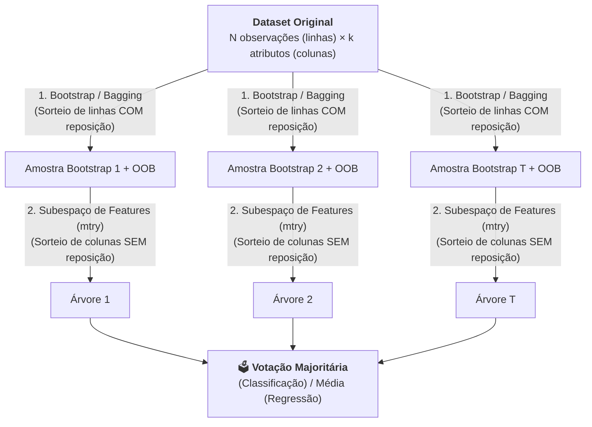
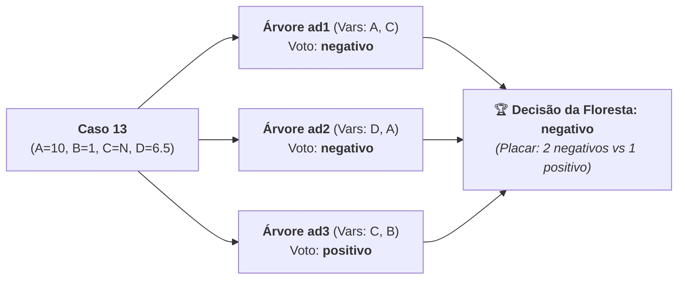

---
aliases:
  - Floresta Aleatória
  - Random Forest
  - Bagging
  - Ensemble de Árvores
tags:
  - machine-learning
  - floresta-aleatoria
  - random-forest
  - ensemble
  - classificacao
  - r
---

# Floresta Aleatória (*Random Forest*) — Guia Completo

A **Floresta Aleatória** (*Random Forest*) é um algoritmo de aprendizado em conjunto (*Ensemble Learning*) que combina centenas ou milhares de [[Árvore de Decisão - Passo a Passo|Árvores de Decisão]] independentes para tomar decisões preditivas muito mais robustas e precisas do que qualquer árvore isolada.

Enquanto uma única árvore de decisão tende a sofrer de **alta variância (*overfitting*)** e instabilidade diante de pequenas mudanças nos dados, a Floresta Aleatória aplica o princípio da *"sabedoria das multidões"*: cada árvore vê uma amostra diferente dos dados e um subconjunto diferente de atributos, e a previsão final emerge por **votação majoritária** (na classificação) ou **média** (na regressão).

---

## 1. Vantagens, Limitações e Taxa de Erro da Floresta

Baseado diretamente no material teórico do curso (`04.1_floresta_aleatoria_teoria`):

| ✅ Vantagens | ⚠️ Desvantagens e Limitações |
| :--- | :--- |
| **Dispensa poda e reduz *overfitting***: A combinação de múltiplas árvores independentes suaviza os erros individuais e melhora a generalização. | **Incapacidade de extrapolação numérica**: Não consegue prever valores fora do intervalo visto no treino. *(Ex.: se o custo foi R\$ 100 para 1 unidade, R\$ 200 para 2 e R\$ 300 para 3, a floresta não prevê R\$ 500 para 5 unidades — algo trivial para a [[Regressão Linear]])*. |
| **Mede importância das variáveis (`varImp`)**: Informa exatamente quais atributos mais contribuíram para a redução da impureza, valioso para análise de negócios. | **Viés para categóricas com muitos níveis**: Atributos com mais de 4 categorias favorecem artificialmente a redução de impureza (2 níveis é bom, 3 é ok, 4 está no limite). |
| **Excelente acurácia fora da caixa**: Funciona muito bem mesmo com os hiperparâmetros padrão em problemas não lineares complexos. | **Perda de explicabilidade ("Caixa-Preta")**: Em uma única árvore, rastreamos a regra exata até a folha. Na floresta, a decisão vem da votação de centenas de árvores, impedindo apontar um único motivo explícito. |

### Do que Depende a Taxa de Erro da Floresta?
A performance da Floresta Aleatória é governada por dois fatores matemáticos simultâneos:
1. **Correlação entre quaisquer duas árvores da floresta**: Quanto **maior a correlação** (similaridade) entre as árvores, **maior será a taxa de erro** da floresta (se todas errarem juntas, a votação não ajuda).
2. **Força individual de cada árvore**: Quanto menor o erro individual de cada árvore (classificador forte), menor o erro coletivo.

> [!IMPORTANT] Regra de Ouro
> O ideal é que a floresta seja composta por **árvores boas (fortes) e diferentes (descorrelacionadas) entre si**.

---

## 2. Como Funciona a Aleatoriedade? (Os 2 Pilares do Algoritmo)

Para garantir que as árvores da floresta sejam diversas entre si, o algoritmo introduz aleatoriedade em **duas dimensões** ao mesmo tempo:



1. **Amostragem *Bootstrap* (*Bagging* — Linhas com Reposição)**:
   * Para construir cada árvore, sorteiam-se observações do conjunto de treino **com reposição** (`replace = TRUE`). Por isso, alguns casos aparecem repetidos na mesma árvore (ex: caso `4` e `4.1`, `10` e `10.1`), enquanto cerca de $1/3$ (~36,8%) dos dados ficam de fora desse sorteio.
   * **Dados *Out-Of-Bag* (OOB)**: As observações que **não foram sorteadas** para treinar uma árvore funcionam como um conjunto de validação interno gratuito! O **Erro OOB** mede a taxa de erro prevendo cada observação apenas com as árvores em que ela ficou de fora.
2. **Seleção Aleatória de Atributos (*Feature Randomness* — `mtry`)**:
   * Em cada divisão (ou árvore), em vez de testar todas as $k$ colunas disponíveis, o algoritmo sorteia apenas um subconjunto de $m$ variáveis **sem reposição** (`replace = FALSE`).
   * Isso impede que uma única variável muito forte domine todas as raízes de todas as árvores, forçando a floresta a explorar interações alternativas e descorrelacionando os modelos.

---

## 3. Exemplo Passo a Passo da Votação (Caso 13 do Material)

No exemplo sintético do curso (20 observações com variáveis `A`, `B`, `C`, `D` $\to$ `resposta`), enquanto uma árvore completa acertou tudo no treino, foram criadas 3 sub-árvores aleatórias com 7 linhas (com reposição) e 2 colunas cada (sem reposição).

Ao submeter o **Caso 13** (desconhecido pelas 3 sub-árvores, com `A=10, B=1, C=N, D=6.5`) à votação:



Mesmo que uma árvore isolada discorde (`ad3`), a decisão final segue o voto da maioria. Quando escalamos de 3 árvores para **500 ou 1.000 árvores**, os erros aleatórios individuais se cancelam mutuamente!

---

## 4. Hiperparâmetros Principais e Ajuste (*Tuning*) no R

No R (pacotes `randomForest` e `caret`), dois hiperparâmetros controlam a arquitetura da floresta:

### 4.1. `mtry` (Quantidade de Variáveis por Divisão)
* Define quantas variáveis candidatas são sorteadas em cada nó para escolher o melhor corte.
* **Regra de bolso da literatura (Classificação)**:
  $$m_{\text{try}} \approx \sqrt{k}$$
  onde $k$ é o número de variáveis preditoras. No estudo do **Titanic** ($k = 7$ preditores: `Pclass`, `Sex`, `SibSp`, `Parch`, `Fare`, `Embarked`, `Age`), $\sqrt{7} \approx 2,65 \implies$ sugere-se testar `mtry = 2` ou `3`.
* **Como encontrar o melhor `mtry` na prática?**
  1. Via `tuneRF()`: Busca iterativamente o `mtry` que minimiza o **OOB Error** (no Titanic, `mtry = 2` obteve OOB error $= 17,67\%$ contra $18,09\%$ para `mtry = 3`).
  2. Via `caret::train(..., method = 'rf', tuneGrid = expand.grid(.mtry = 1:7))`: Avalia todos os valores de 1 a 7 via reamostragem.

### 4.2. `ntree` (Número de Árvores na Floresta)
* O padrão em R é **`ntree = 500`**.
* Aumentar `ntree` **não causa overfitting** (ao contrário de aumentar a profundidade de uma única árvore!), apenas estabiliza a variância da votação até atingir um platô — porém aumenta o tempo computacional.

### Comparativo Visual do Tuning no Estudo de Caso Titanic (`mtry` vs `ntree`)

O gráfico interativo abaixo reproduz os resultados exatos do treinamento no material do curso (`04.1_floresta_aleatoria_teoria.pdf`), comparando a acurácia de validação cruzada para `mtry` de 1 a 7 entre diferentes quantidades de árvores (`250`, `500`, `750` e `1000`):

```plotly
data:
  - x: [1, 2, 3, 4, 5, 6, 7]
    y: [0.7865, 0.8136, 0.8152, 0.8093, 0.7999, 0.7917, 0.7880]
    type: scatter
    mode: lines+markers
    name: 'ntree = 250'
    line:
      color: '#ff7f0e'
      width: 2
  - x: [1, 2, 3, 4, 5, 6, 7]
    y: [0.7861, 0.8109, 0.8073, 0.8026, 0.7934, 0.7875, 0.7840]
    type: scatter
    mode: lines+markers
    name: 'ntree = 500 (Padrão)'
    line:
      color: '#1f77b4'
      width: 2
      dash: dash
  - x: [1, 2, 3, 4, 5, 6, 7]
    y: [0.7870, 0.8109, 0.8160, 0.8058, 0.8006, 0.7960, 0.7905]
    type: scatter
    mode: lines+markers
    name: 'ntree = 750'
    line:
      color: '#9467bd'
      width: 2
  - x: [1, 2, 3, 4, 5, 6, 7]
    y: [0.7931, 0.8123, 0.8167, 0.8123, 0.8045, 0.7969, 0.7934]
    type: scatter
    mode: lines+markers
    name: 'ntree = 1000 (Máx: 0.8167 em mtry=3)'
    line:
      color: '#2ca02c'
      width: 3
layout:
  title: 'Tuning de Floresta Aleatória no Titanic: Acurácia vs mtry e ntree'
  xaxis:
    title: 'Parâmetro mtry (Variáveis Sorteadas por Divisão)'
    tickvals: [1, 2, 3, 4, 5, 6, 7]
  yaxis:
    title: 'Acurácia (Bootstrapped)'
  hovermode: 'closest'
```

> [!NOTE] Leitura do Gráfico de Tuning
> * Observe que quando `mtry = 7` (todas as variáveis são testadas em todos os nós — o que equivale ao *Bagging* puro sem seleção aleatória de features), a acurácia **cai** porque as árvores ficam muito parecidas entre si (correlação alta)!
> * O pico de acurácia ocorre em **`mtry = 2` ou `3`** (bem próximo do $\sqrt{7} \approx 2,65$ recomendado pela teoria).

---

## 5. Estudo de Caso Titanic: Imputação de NAs e Importância de Variáveis

No estudo de caso Titanic da aula (`891` observações, separadas em `713` treino e `178` teste), o professor demonstra duas lições essenciais de engenharia e diagnóstico:

### 5.1. Imputação Inteligente de Dados Perdidos (`Age`)
A variável `Age` possuía $143$ valores ausentes (`NA`) no treino ($20\%$). Em vez de descartar a coluna ou preencher todos os `NA`s com uma média global única, um boxplot cruzando `Sex` e `Pclass` revelou que passageiros da 1ª classe eram significativamente mais velhos que os da 3ª classe.
* **Ação aplicada**: Imputar os `NA`s de `Age` com a **média condicional de seu próprio grupo** (`Pclass` $\times$ `Sex`).
* **Resultado**: Ao incluir `Age` imputada (`mod_age`), os falsos negativos caíram de $84$ para $71$, elevando a **Acurácia Balanceada no treino de $0,8855$ para $0,9030$** (e atingindo **$0,8504$ na validação**).

### 5.2. Importância das Variáveis (`varImp`)
No modelo baseline do Titanic, a importância relativa extraída pelo `caret` (e representada após o *One-Hot Encoding* automático aplicado pelo pacote) revelou quais atributos guiaram a sobrevivência:

```plotly
data:
  - y: ['EmbarkedQ', 'Pclass.Q', 'EmbarkedS', 'SibSp', 'Parch', 'Pclass.L', 'Fare', 'Sexmale']
    x: [0.0, 2.59, 3.92, 12.26, 14.40, 27.21, 57.88, 100.0]
    type: bar
    orientation: 'h'
    marker:
      color: ['#aec7e8', '#aec7e8', '#aec7e8', '#6baed6', '#6baed6', '#3182bd', '#1f77b4', '#08519c']
layout:
  title: 'Importância Relativa de Variáveis na Floresta Aleatória (Titanic)'
  xaxis:
    title: 'Importância Normalizada (0 a 100)'
  yaxis:
    title: 'Atributo (após One-Hot Encoding)'
```

*(Note como `Sexmale` foi o fator mais decisivo — 100% — seguido pelo preço da passagem `Fare` e classe social `Pclass`, confirmando a regra histórica de "mulheres e crianças primeiro" e prioridade das classes superiores).*

---

## 6. Resumo Comparativo: Árvore Única vs Floresta Aleatória

| Critério | [[Árvore de Decisão - Passo a Passo\|Árvore de Decisão Única (`rpart`)]] | Floresta Aleatória (`randomForest` / `rf`) |
| :--- | :--- | :--- |
| **Estrutura** | Apenas 1 árvore hierárquica. | Centenas/milhares de árvores independentes (`ntree = 500`). |
| **Risco de *Overfitting*** | Alto (exige pré-poda ou pós-poda com `prune` e `cp`). | Muito baixo (o voto médio estabiliza a variância). |
| **Interpretabilidade** | Alta (regra explícita visualizável com `rpart.plot`). | Baixa ("caixa-preta" na previsão individual; compensada por `varImp`). |
| **Desempenho Preditivo** | Moderado; sensível a pequenas variações na amostra. | Elevado e estável. |
| **Principais Controles** | `cp`, `minsplit`, `minbucket`, `maxdepth`, `loss`. | `mtry` ($\approx \sqrt{k}$) e `ntree`. |
