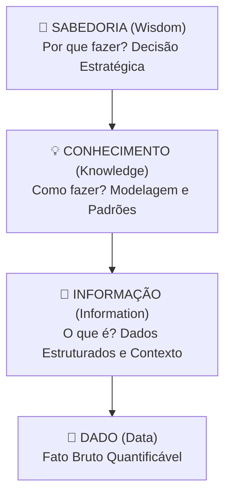

---
aliases:
  - Ciência de Dados
  - Data Science
  - Conceitos de Ciência de Dados
  - Pirâmide DIKW
tags:
  - conceitos
  - fundamentos
  - data-science
  - metodologia
---

# Fundamentos de Ciência de Dados

A **Ciência de Dados** (*Data Science*) é um campo interdisciplinar que combina princípios da **estatística**, da **ciência da computação** e do **conhecimento de negócios** com o propósito de extrair insights acionáveis, identificar padrões ocultos e construir modelos matemáticos preditivos a partir de grandes conjuntos de dados.

Historicamente, o tratamento de dados era conduzido prioritariamente por estatísticos que trabalhavam com pequenas amostras coletadas manualmente. Com o advento da internet, a explosão de dispositivos conectados, as redes sociais e a evolução exponencial do poder de processamento computacional, a humanidade passou a produzir um volume sem precedentes de dados, originando o fenômeno de [[Big Data e Computação Distribuída]]. Nesse cenário, surgiu a necessidade de uma disciplina unificada capaz de operar em todas as etapas do ciclo analítico.

---

## 1. A Hierarquia da Informação: Pirâmide DIKW

Para atuar com rigor em Ciência de Dados, é indispensável compreender as distinções ontológicas entre **Dado**, **Informação**, **Conhecimento** e **Sabedoria**:



### 1.1. Dado (*Data*)
- **Definição**: É a unidade básica e elementar de registro. Trata-se de um conteúdo quantificável associado a uma entidade ou a um evento observável.
- **Propriedades**: Não possui significado intrínseco, não fornece contexto por si só e é desprovido de utilidade imediata para tomada de decisões.
- **Exemplos Práticos**:
  - `1,78` $\to$ Representa uma altura em metros? Uma proporção financeira? Um escore de teste? Sem metadados, o número é inerte.
  - `R$ 470.000,00` $\to$ É o custo de uma obra? O faturamento anual de uma empresa? O preço de um imóvel? É muito ou é pouco?

### 1.2. Informação (*Information*)
- **Definição**: É o **dado analisado, estruturado, contextualizado e organizado**.
- **Propriedades**: A informação adquire significado e utilidade direta ao responder perguntas básicas como *"quem"*, *"o que"*, *"onde"* e *"quando"*.
- **Exemplo Prático**:
  - *"O paciente João da Silva possui altura de 1,78 m e pressão arterial de 120/80 mmHg aferida às 14:00 do dia 15 de março."* Aqui, os dados brutos ganham contexto clínico imediato.

### 1.3. Conhecimento (*Knowledge*)
- **Definição**: É a **informação entendida, interpretada, processada, internalizada e aplicada**.
- **Propriedades**: O conhecimento confere a capacidade de **modelar um evento**, compreender relações de causalidade ou correlação e capacitar o tomador de decisão a executar ações práticas fundamentadas.
- **Exemplo Prático**:
  - *"Historicamente, pacientes com estatura acima de 1,75 m submetidos à dosagem terapêutica X apresentam redução de 40% na reincidência de sintomas crônicos."* Permite a prescrição personalizada de tratamentos.

### 1.4. Sabedoria (*Wisdom*)
- **Definição**: Representa o ápice da pirâmide, envolvendo o julgamento crítico, ético e holístico sobre o impacto de longo prazo das decisões tomadas a partir do conhecimento adquirido.

---

## 2. Estrutura Operacional e Divisão de Papéis em Equipes de Dados

A execução bem-sucedida de iniciativas de dados nas organizações modernas demanda uma divisão coordenada de competências entre diferentes perfis profissionais:

| Perfil Profissional | Foco Primário | Atividades Centrais | Ferramentas Principais |
| :--- | :--- | :--- | :--- |
| **Engenheiro de Dados** | Infraestrutura e Fluxo | Levantamento, ingestão, arquitetura de pipelines, limpeza massiva e prospecção de fontes em [[Extração e Tratamento de Dados (ETL)]]. | SQL, Apache Spark, Hadoop, Kafka, Python, Airflow |
| **Analista de BI (*Business Intelligence*)** | Negócio e Histórico | Construção de painéis executivos, consolidação de KPIs, geração de relatórios gerenciais sobre o desempenho passado em [[Business Intelligence e Análise de Negócios]]. | Power BI, Tableau, SQL, Cubos OLAP |
| **Cientista de Dados** | Modelagem e Futuro | Aplicação de ferramental matemático avançado, análise exploratória profunda e treinamento de modelos de [[Aprendizado de Máquina]] para antecipar desfechos. | [[Introdução ao R|R]], Python, [[Ambiente de Desenvolvimento Jupyter|Jupyter]], Scikit-Learn |

---

## 3. Os Quatro Níveis de Análise de Dados

A maturidade analítica de uma organização progride ao longo de quatro dimensões de complexidade e valor gerado:

```plotly
data:
  - x: [1, 2, 3, 4]
    y: [1, 2, 3, 4]
    text: ['1. Descritiva: O que aconteceu?', '2. Diagnóstica: Por que aconteceu?', '3. Preditiva: O que vai acontecer?', '4. Prescritiva: Como agir?']
    textposition: 'top left'
    mode: lines+markers+text
    type: scatter
    name: 'Maturidade Analítica'
    marker:
      color: ['#1f77b4', '#ff7f0e', '#2ca02c', '#d62728']
      size: 14
    line:
      color: '#333333'
      width: 2.5
      dash: dash
layout:
  title: 'Graus de Maturidade Analítica: Complexidade vs Valor Gerado'
  xaxis:
    title: 'Valor Agregado ao Negócio'
    tickvals: [1, 2, 3, 4]
    ticktext: ['Baixo', 'Moderado', 'Elevado', 'Estratégico / Máximo']
    range: [0.5, 4.5]
  yaxis:
    title: 'Complexidade Metodológica e Tecnológica'
    tickvals: [1, 2, 3, 4]
    ticktext: ['Baixa', 'Média', 'Alta', 'Avançada']
    range: [0.5, 4.5]
  hovermode: 'closest'
```

### 3.1. Análise Descritiva (*Descriptive Analytics*)
- **Objetivo**: Responder *"O que aconteceu?"*.
- **Horizonte Temporal**: Passado.
- **Entregáveis**: Relatórios contábeis, gráficos de vendas trimestrais, painéis de monitoramento e medidas de resumo estatístico (média, desvio padrão, percentis).

### 3.2. Análise Diagnóstica (*Diagnostic Analytics*)
- **Objetivo**: Responder *"Por que aconteceu?"*.
- **Horizonte Temporal**: Passado/Presente.
- **Entregáveis**: Análise de causa-raiz, mineração de regras de associação, correlações bivariadas e detalhamento analítico (*drill-down*) de anomalias operacionais.

### 3.3. Análise Preditiva (*Predictive Analytics*)
- **Objetivo**: Responder *"O que vai acontecer?"*.
- **Horizonte Temporal**: Futuro.
- **Entregáveis**: Modelos de [[Regressão Linear]] para estimar preços ou faturamentos contínuos; modelos de [[Regressão Logística]] e [[Árvores de Decisão]] para prever inadimplência ou probabilidade de churn de clientes.

### 3.4. Análise Prescritiva (*Prescriptive Analytics*)
- **Objetivo**: Responder *"O que devemos fazer para maximizar o melhor resultado?"*.
- **Horizonte Temporal**: Futuro com Ação Automatizada.
- **Entregáveis**: Algoritmos de otimização linear e não linear, motores de precificação dinâmica de companhias aéreas, sistemas autônomos de tomada de decisão.

---

## 4. O Ciclo Metodológico de Projetos (CRISP-DM)

A metodologia padrão da indústria para conduzir projetos de mineração e ciência de dados é o **CRISP-DM** (*Cross-Industry Standard Process for Data Mining*), estruturado em seis fases iterativas:

1. **Compreensão do Negócio (*Business Understanding*)**: Definição clara dos objetivos estratégicos, formulação do problema sob a ótica da organização e especificação dos critérios de sucesso.
2. **Compreensão dos Dados (*Data Understanding*)**: Coleta inicial, exploração estatística, inspeção de variáveis e identificação preliminar de inconsistências.
3. **Preparação dos Dados (*Data Preparation*)**: A fase mais intensiva do projeto (consumindo de 50% a 80% do tempo total), onde ocorrem a limpeza, seleção de atributos, tratamento de valores nulos e codificação em [[Extração e Tratamento de Dados (ETL)]] e [[Pré-Processamento e Engenharia de Atributos]].
4. **Modelagem (*Modeling*)**: Seleção e calibração de algoritmos estatísticos e de machine learning, como [[Regressão Linear]], [[Regressão Logística]] e [[Árvores de Decisão]].
5. **Avaliação (*Evaluation*)**: Verificação rigorosa do desempenho do modelo segundo métricas matemáticas e objetivos de negócio, utilizando [[Métricas de Avaliação de Modelos]] ([[Acurácia]], [[Recall]], [[Precisão]], [[F1-Score]], [[Curva ROC]]).
6. **Implantação (*Deployment*)**: Integração do modelo treinado em ambientes produtivos de tomada de decisão e monitoramento contínuo da degradação temporal da performance.

---

## 5. Relação entre Negócios e Dados

Historicamente, o cruzamento entre negócios e dados gerava apenas **relatórios retrospectivos** consolidados em fechamentos mensais. No paradigma moderno impulsionado por [[Fundamentos de Ciência de Dados]], o objetivo primordial desloca-se da documentação do passado para a **construção de previsões de futuro**:

- Previsão de demanda e estoques otimizados;
- Detecção precoce de fraudes em tempo real;
- Manutenção preditiva de maquinário industrial;
- Recomendação hiperpersonalizada de produtos e serviços.

Essa transição metodológica é materializada por meio de experimentações computacionais conduzidas no [[Ambiente de Desenvolvimento Jupyter]] utilizando linguagens dedicadas como [[Introdução ao R|R]] e comunicadas por meio de [[Visualização de Dados com Plotly]].
