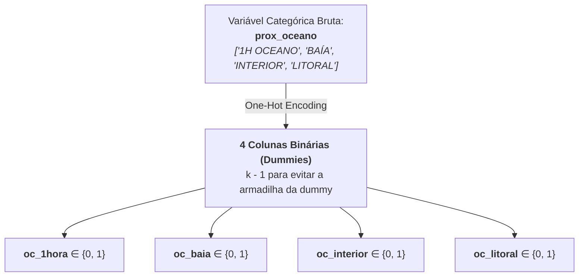

---
aliases:
  - Leitura de Gráficos
  - Interpretação de Gráficos
  - Guia Visual de Modelos
  - Gráficos para Prova
tags:
  - visualizacao
  - interpretacao
  - graficos
  - data-science
  - diagnostico
  - modelos
---

# Guia Completo de Leitura e Interpretação de Gráficos em Ciência de Dados

Em avaliações e no dia a dia do cientista de dados, a capacidade de **ler, interpretar e justificar decisões técnicas com base em gráficos** é infinitamente mais valorizada do que a memorização mecânica de sintaxe de programação. Um modelo treinado nunca deve ser aceito apenas por um número isolado de $R^2$ ou acurácia; é a inspeção visual que expõe desvios de premissas, sobreajuste, presença de *outliers* destrutivos e relacionamentos não lineares.

Este guia reúne **todos os tipos fundamentais de gráficos** abordados ao longo do curso, com múltiplos exemplos interativos em [[Visualização de Dados com Plotly|Plotly]], detalhamento anatômico de cada componente e regras explícitas de interpretação para justificar intervenções em modelos preditivos.

---

## 🎯 Protocolo Universal de Leitura Gráfica em Provas (4 Passos)

Sempre que se deparar com uma questão de interpretação visual, execute este checklist analítico antes de responder:

1. **Inspeção de Escalas e Eixos**:
   * O que está no eixo horizontal ($X$) e no vertical ($Y$)?
   * As variáveis são contínuas ou categóricas?
   * A escala inclui zero, é logarítmica ou padronizada ($Z$-score / Min-Max)?
2. **Identificação da Tendência Central e Dispersão**:
   * Onde se concentram a maioria dos pontos? Existe simetria ou cauda longa?
   * O relacionamento entre as variáveis é linear, curvilíneo, monótono ou inexistente?
3. **Detecção de Anomalias (*Outliers* e Padrões)**:
   * Há pontos isolados longe da massa principal?
   * A dispersão é uniforme (homocedasticidade) ou varia com o aumento de $X$ (heterocedasticidade em forma de cone)?
4. **Tradução em Ação Modelar**:
   * O que essa figura exige que você faça no modelo? (Ex.: adicionar termo quadrático $X^2$, alterar limiar de corte $\theta$, aplicar logaritmo, tratar valores sentinelas ou podar complexidade).

---

## 📦 1. Diagramas de Caixa (*Box-plots*)

O **Box-plot** (desenvolvido por John Tukey) é a ferramenta gráfica definitiva para inspecionar a distribuição de variáveis contínuas, comparar grupos categóricos e identificar assimetrias e valores atípicos (*outliers*).

### Exemplo 1.1: Anatomia Completa de um Box-plot Univariado
*Contexto: Distribuição de Preços de Imóveis (em milhares de R$).*

```plotly
data:
  - y: [120, 150, 160, 175, 180, 190, 195, 200, 210, 215, 220, 230, 240, 250, 260, 275, 290, 310, 320, 480, 520]
    type: box
    name: 'Preço Imóveis'
    boxpoints: 'outliers'
    marker:
      color: '#1f77b4'
      size: 7
layout:
  title: 'Anatomia Estatística do Box-plot (Distribuição de Preços)'
  yaxis:
    title: 'Preço (R$ mil)'
```

#### Anatomia dos Elementos do Gráfico:
* **Linha Central da Caixa (Mediana / $Q_2$)**: Representa o percentil 50 ($50\%$ dos dados estão abaixo e $50\%$ acima). Ao contrário da média, é robusta e insensível a valores extremos.
* **Borda Inferior da Caixa ($Q_1$ — 1º Quartil)**: Percentil 25. Delimita o quarto inferior da amostra.
* **Borda Superior da Caixa ($Q_3$ — 3º Quartil)**: Percentil 75. Delimita os $75\%$ inferiores da amostra.
* **Altura da Caixa (Intervalo Interquartil — $IQR$)**: $IQR = Q_3 - Q_1$. Representa a dispersão dos $50\%$ centrais das observações.
* **Bigode Inferior (*Lower Whisker*)**: O menor valor observado que ainda é maior ou igual a $Q_1 - 1,5 \times IQR$.
* **Bigode Superior (*Upper Whisker*)**: O maior valor observado que ainda é menor ou igual a $Q_3 + 1,5 \times IQR$.
* **Pontos Isolados além dos Bigodes (*Outliers*)**: Observações que caem além das cercas ($> Q_3 + 1,5 \times IQR$ ou $< Q_1 - 1,5 \times IQR$).

#### Como Interpretar na Prova:
* **Assimetria**: Se a mediana está mais próxima de $Q_1$ e o bigode superior é bem mais longo que o inferior (com pontos isolados no topo), a distribuição possui **assimetria positiva (à direita)**.
* **Justificativa de Ação**: Variáveis com forte assimetria à direita em modelos lineares se beneficiam fortemente de uma transformação logarítmica $\ln(Y)$ para estabilizar a variância e aproximar a distribuição da normalidade.

---

### Exemplo 1.2: Box-plot Comparativo Bivariado entre Classes
*Contexto: Comparação do Escore de Crédito entre tomadores Aprovados versus Recusados (Dataset Bancário).*

```plotly
data:
  - y: [520, 540, 560, 575, 590, 600, 610, 620, 630, 635, 640, 650, 660, 675, 710]
    type: box
    name: 'Recusados (Classe 0)'
    marker:
      color: '#d62728'
  - y: [650, 670, 690, 700, 715, 725, 740, 755, 770, 785, 800, 815, 830, 850, 880]
    type: box
    name: 'Aprovados (Classe 1)'
    marker:
      color: '#2ca02c'
layout:
  title: 'Poder de Separação de Atributo: Escore por Decisão de Crédito'
  yaxis:
    title: 'Escore de Crédito (Pontuação)'
```

#### Como Interpretar na Prova:
* **Poder de Separação (Preditividade)**: Observe o grau de sobreposição (*overlap*) entre as caixas.
  * Se as caixas e as medianas estão amplamente afastadas e a sobreposição é baixa, a variável preditora possui **alto poder discriminatório** para modelos como [[Regressão Logística]] e [[Árvores de Decisão]].
  * Se as caixas estivessem totalmente alinhadas na mesma altura com medianas iguais, a variável seria irrelevante para discriminar as classes e poderia ser descartada no processo de seleção de atributos.
* **Justificativa de Ação**: O escore de crédito deve ser mantido como preditor prioritário no modelo logístico; espera-se que seu coeficiente $\beta$ seja estatisticamente significativo ($p\text{-valor} < 0,05$) com sinal positivo.

---

### Exemplo 1.3: Box-plot com Detecção de Falhas de Sensor / Valores Sentinela
*Contexto: Medição de Umidade Relativa do Ar e Temperatura (Dataset Meteorológico CEPAGRI).*

```plotly
data:
  - y: [55, 58, 62, 65, 67, 70, 72, 75, 78, 80, 82, 85, 88, 90, 92, 95, 999.0, 999.0, -99.0]
    type: box
    name: 'Leitura Bruta Sensor'
    marker:
      color: '#ff7f0e'
layout:
  title: 'Detecção Gráfica de Valores Sentinela de Hardware'
  yaxis:
    title: 'Umidade Registrada (%)'
```

#### Como Interpretar na Prova:
* **Identificação de Código Sentinela**: A presença de pontos isolados em valores bizarros e extremos (como $+999,0$ ou $-99,0$), totalmente descolados da física do fenômeno (umidade não passa de $100\%$), denuncia que o fabricante do hardware configurou esses números como **códigos de falha de transmissão**, e não como dados reais.
* **Justificativa de Ação em [[Extração e Tratamento de Dados (ETL)|ETL]]**: Esses valores **não podem** ser tratados como observações válidas nem corrigidos por simples média ingênua. Devem ser convertidos em valores nulos (`NA`) e posteriormente tratados via imputação temporal ou remoção pontual antes da estimação de parâmetros.

---

## 📈 2. Gráficos de Dispersão (*Scatter Plots*)

O **Gráfico de Dispersão** plota pares ordenados $(X_i, Y_i)$ no plano cartesiano, sendo o instrumento primordial para inspecionar a forma funcional da relação entre duas variáveis contínuas em [[Regressão Linear]].

### Exemplo 2.1: Dispersão Linear com Linha de Ajuste OLS
*Contexto: Estimação de Peso (kg) a partir da Altura (m) — Dataset `women`.*

```plotly
data:
  - x: [1.47, 1.50, 1.52, 1.55, 1.57, 1.60, 1.63, 1.65, 1.68, 1.70, 1.73, 1.75, 1.78, 1.80, 1.83]
    y: [52.2, 53.1, 54.5, 55.8, 57.2, 58.7, 60.1, 61.5, 63.2, 64.6, 66.4, 67.9, 69.8, 71.5, 73.4]
    type: scatter
    mode: markers
    name: 'Observações Reais'
    marker:
      color: '#1f77b4'
      size: 9
  - x: [1.45, 1.85]
    y: [49.53, 74.07]
    type: scatter
    mode: lines
    name: 'Reta OLS: ŷ = -39.4 + 61.4*altura'
    line:
      color: '#ff7f0e'
      width: 2.5
layout:
  title: 'Dispersão Bivariada: Altura versus Peso'
  xaxis:
    title: 'Altura (m)'
  yaxis:
    title: 'Peso (kg)'
  hovermode: 'closest'
```

#### Anatomia dos Elementos:
* **Eixo Horizontal ($X$)**: Variável explicativa / preditora / independente (`altura`).
* **Eixo Vertical ($Y$)**: Variável resposta / dependente (`peso`).
* **Inclinação da Reta ($\hat{\beta}_1$)**: Representa a taxa marginal de variação de $Y$ para cada unidade acrescida em $X$ ($\Delta \hat{Y} / \Delta X$). Aqui, $\hat{\beta}_1 = 61,4 > 0 \implies$ relação diretamente proporcional.
* **Intercepto com o Eixo Vertical ($\hat{\beta}_0$)**: Onde a reta toca o eixo $Y$ quando $X = 0$.
* **Distância Vertical de cada Ponto à Reta**: Corresponde exatamente ao **resíduo amostral** $e_i = Y_i - \hat{Y}_i$.

---

### Exemplo 2.2: Dispersão Curvilínea Não Linear (Padrão Parabólico)
*Contexto: Relação entre Velocidade do Veículo (km/h) e Consumo de Combustível (litros por 100 km).*

```plotly
data:
  - x: [20, 30, 40, 50, 60, 70, 80, 90, 100, 110, 120, 130, 140]
    y: [11.5, 9.8, 8.2, 7.1, 6.5, 6.2, 6.4, 6.9, 7.8, 9.0, 10.5, 12.4, 14.8]
    type: scatter
    mode: markers
    name: 'Dados Reais Amostrais'
    marker:
      color: '#2ca02c'
      size: 9
  - x: [20, 140]
    y: [8.5, 10.2]
    type: scatter
    mode: lines
    name: 'Reta Linear Inadequada (OLS 1º grau)'
    line:
      color: '#d62728'
      dash: dash
      width: 2
  - x: [20, 30, 40, 50, 60, 70, 80, 90, 100, 110, 120, 130, 140]
    y: [11.6, 9.6, 8.1, 7.0, 6.3, 6.2, 6.5, 7.2, 8.3, 9.7, 11.5, 13.6, 16.0]
    type: scatter
    mode: lines
    name: 'Curva Ajustada: Polinômio 2º Grau (X²)'
    line:
      color: '#1f77b4'
      width: 3
layout:
  title: 'Não Linearidade Evidente: Velocidade vs Consumo'
  xaxis:
    title: 'Velocidade Média (km/h)'
  yaxis:
    title: 'Consumo (L/100 km)'
  hovermode: 'closest'
```

#### Como Interpretar na Prova:
* **Falha da Reta Simples**: A reta linear tracejada em vermelho cruza os pontos de forma grosseira: ela superestima no centro e subestima nas pontas, gerando resíduos sistematicamente viciados.
* **Justificativa de Ação**: O relacionamento físico possui um ponto de mínimo e concavidade para cima. O modelo linear simples **viola a premissa de linearidade**. A ação correta é especificar um **modelo polinomial de 2º grau**:
  $$Y = \beta_0 + \beta_1 X + \beta_2 X^2 + \epsilon$$

---

### Exemplo 2.3: Dispersão com Heterocedasticidade ("Formato de Cone / Funil")
*Contexto: Renda Familiar Mensal versus Gastos Discricionários em Lazer.*

```plotly
data:
  - x: [1000, 1200, 1500, 1800, 2000, 2200, 2500, 3000, 3500, 4000, 4500, 5000, 6000, 7000, 8000, 9000, 10000]
    y: [150, 180, 210, 240, 310, 270, 420, 480, 750, 600, 1200, 950, 1800, 2400, 1600, 3200, 4500]
    type: scatter
    mode: markers
    name: 'Famílias Observadas'
    marker:
      color: '#9467bd'
      size: 8
  - x: [1000, 10000]
    y: [150, 3600]
    type: scatter
    mode: lines
    name: 'Tendência Média OLS'
    line:
      color: '#333'
      width: 2
layout:
  title: 'Heterocedasticidade Clássica: Padrão em Leque / Funil'
  xaxis:
    title: 'Renda Mensal (R$)'
  yaxis:
    title: 'Gasto em Lazer (R$)'
```

#### Como Interpretar na Prova:
* **Diagnóstico Visual**: A dispersão vertical dos pontos em torno da reta é quase nula para rendas baixas ($R\$ 1.000$), mas explode em amplitude para rendas elevadas ($R\$ 10.000$).
* **Violação Teórica**: Isso viola a premissa de **Homocedasticidade** do Teorema de Gauss-Markov ($\text{Var}(\epsilon_i) \neq \sigma^2$). Os coeficientes continuam não viesados, mas os testes de hipótese ($t$ e $F$) e os erros-padrão tornam-se inválidos.
* **Justificativa de Ação**: Aplicar uma transformação estabilizadora de variância, tipicamente a **transformação logarítmica** na variável dependente: $\ln(\text{Gastos}) = \beta_0 + \beta_1 \ln(\text{Renda}) + \epsilon$.

---

## 🔲 3. Grade de Gráficos de Dispersão (*Scatter Matrix / Pairplot*)

A **Grade de Dispersão** (*Scatter Plot Matrix*) exibe em uma única matriz visual todas as combinações bivariadas possíveis de um conjunto multivariado de dados, com a distribuição univariada de cada variável disposta ao longo da diagonal principal.

### Exemplo 3.1: Matriz de Dispersão Reduzida dos Estados Americanos (`state.x77`)
*Contexto: Análise Bivariada Cruzada de Assassinatos (`Murder`), Analfabetismo (`Illiteracy`) e Expectativa de Vida (`Life.Exp`).*

```plotly
data:
  - type: splom
    dimensions:
      - label: 'Assassinatos (por 100k)'
        values: [15.1, 11.3, 7.8, 10.1, 10.3, 6.8, 3.1, 6.2, 10.7, 13.9, 6.2, 5.3, 10.3, 7.1, 2.3]
      - label: 'Analfabetismo (%)'
        values: [2.1, 1.5, 1.8, 1.9, 1.1, 0.7, 1.1, 0.9, 1.3, 2.0, 1.9, 0.6, 0.9, 0.7, 0.5]
      - label: 'Expectativa Vida (Anos)'
        values: [69.05, 69.31, 70.55, 70.66, 71.71, 72.06, 72.48, 70.06, 70.95, 68.54, 69.48, 71.87, 70.14, 72.56, 72.96]
    marker:
      color: '#d62728'
      size: 7
layout:
  title: 'Grade de Dispersão Multivariada: state.x77'
  hovermode: 'closest'
```

#### Como Interpretar na Prova:
1. **Cruzamento `Assassinatos` $\times$ `Analfabetismo`**:
   * Nuvem de pontos ascendente com inclinação positiva bem definida. Estados com maior taxa de analfabetismo sofrem com taxas substancialmente mais elevadas de homicídios.
2. **Cruzamento `Assassinatos` $\times$ `Expectativa de Vida`**:
   * Nuvem de pontos descendente com inclinação negativa expressiva. Maior violência reduz a expectativa de vida média populacional.
3. **Cruzamento `Analfabetismo` $\times$ `Expectativa de Vida`**:
   * Relação inversa: populações com maior escolaridade desfrutam de maior longevidade.
4. **Detecção de Multicolinearidade**: Se duas variáveis preditoras em uma grade apresentarem uma dispersão em linha reta quase perfeita entre si, elas transmitem informação redundante. No modelo de regressão múltipla, isso inflacionará os erros-padrão dos coeficientes (VIF alto).

---

## 🔥 4. Gráficos de Correlação (*Correlation Heatmaps*)

A **Matriz de Correlação** quantifica a força e a direção da associação linear bivariada entre todos os pares de variáveis contínuas por meio do coeficiente de correlação linear de Pearson ($r$):

$$r = \frac{\sum (X_i - \bar{X})(Y_i - \bar{Y})}{\sqrt{\sum (X_i - \bar{X})^2 \sum (Y_i - \bar{Y})^2}}, \quad r \in [-1, +1]$$

### Exemplo 4.1: Heatmap de Correlação dos Indicadores de `state.x77`
*Contexto: Seleção de variáveis e diagnóstico de multicolinearidade em Regressão Múltipla.*

```plotly
data:
  - z:
      - [ 1.00,  0.34, -0.07,  0.70, -0.78, -0.53]
      - [ 0.34,  1.00,  0.21,  0.31, -0.07, -0.10]
      - [-0.07,  0.21,  1.00, -0.23,  0.34,  0.44]
      - [ 0.70,  0.31, -0.23,  1.00, -0.68, -0.66]
      - [-0.78, -0.07,  0.34, -0.68,  1.00,  0.58]
      - [-0.53, -0.10,  0.44, -0.66,  0.58,  1.00]
    x: ['Assassinatos', 'População', 'Renda', 'Analfabetismo', 'Expectativa Vida', 'Ensino Médio']
    y: ['Assassinatos', 'População', 'Renda', 'Analfabetismo', 'Expectativa Vida', 'Ensino Médio']
    type: heatmap
    colorscale: 'RdBu'
    reversescale: true
    zmin: -1
    zmax: 1
    showscale: true
layout:
  title: 'Matriz de Correlação Linear de Pearson (state.x77)'
```

#### Como Interpretar na Prova:
* **Diagonal Principal**: Sempre igual a $+1,00$, pois qualquer variável correlacionada consigo mesma tem associação linear perfeita.
* **Valores Próximos de $+1,0$ (Vermelho Intenso)**: Correlação linear positiva forte. Exemplo: `Assassinatos` e `Analfabetismo` ($r = +0,70$).
* **Valores Próximos de $-1,0$ (Azul Intenso)**: Correlação linear negativa forte. Exemplo: `Assassinatos` e `Expectativa Vida` ($r = -0,78$).
* **Valores Próximos de $0,0$ (Tons Claros / Neutros)**: Ausência de relacionamento linear. Exemplo: `Assassinatos` e `Renda` ($r = -0,07$).
* **Alerta Crítico para a Prova (Multicolinearidade)**:
  * Se o objetivo for prever `Expectativa Vida`, incluir conjuntamente `Analfabetismo` e `Ensino Médio` (que possuem alta correlação negativa entre si: $r = -0,66$) pode inflacionar os coeficientes e inverter sinais intuitivos. O pesquisador deve justificar a remoção de uma das duas ou usar regularização.

---

## 🎯 5. Curvas de Avaliação de Modelos Preditivos

### Exemplo 5.1: A Curva ROC e a Comparação de Múltiplos Modelos
*Contexto: Comparação do desempenho preditivo entre três classificadores binários.*

```plotly
data:
  - x: [0.0, 0.02, 0.05, 0.10, 0.15, 0.25, 0.40, 0.60, 0.80, 1.0]
    y: [0.0, 0.55, 0.78, 0.88, 0.93, 0.96, 0.98, 0.99, 1.0, 1.0]
    type: scatter
    mode: lines+markers
    name: 'Modelo A: Regressão Logística (AUC = 0.94)'
    line:
      color: '#1f77b4'
      width: 3
  - x: [0.0, 0.05, 0.12, 0.20, 0.35, 0.50, 0.70, 0.85, 1.0]
    y: [0.0, 0.35, 0.58, 0.70, 0.80, 0.86, 0.91, 0.96, 1.0]
    type: scatter
    mode: lines+markers
    name: 'Modelo B: Árvore Sem Poda (AUC = 0.79)'
    line:
      color: '#ff7f0e'
      width: 2.5
      dash: dot
  - x: [0.0, 1.0]
    y: [0.0, 1.0]
    type: scatter
    mode: lines
    name: 'Baseline Aleatório / Chute (AUC = 0.50)'
    line:
      color: '#7f7f7f'
      dash: dash
      width: 1.5
  - x: [0.0]
    y: [1.0]
    type: scatter
    mode: markers
    name: 'Classificador Perfeito (0, 1)'
    marker:
      color: '#2ca02c'
      size: 11
layout:
  title: 'Comparativo de Curvas ROC e Métrica AUC'
  xaxis:
    title: 'Taxa de Falsos Positivos (FPR = 1 - Especificidade)'
    range: [-0.02, 1.02]
  yaxis:
    title: 'Taxa de Verdadeiros Positivos (TPR = Recall)'
    range: [-0.02, 1.05]
  hovermode: 'closest'
```

#### Como Interpretar na Prova:
1. **Regra de Dominância**: Uma curva que se mantém estritamente **acima e à esquerda** de outra em todo o gráfico é estocasticamente superior, garantindo maior taxa de verdadeiros positivos para qualquer nível aceitável de alarmes falsos. O **Modelo A domina o Modelo B**.
2. **Interpretação do AUC**:
   * $\text{AUC} = 0,50$: Desempenho equivalente ao lançamento de uma moeda não viciada (sem utilidade).
   * $\text{AUC} \in [0,80, 0,90]$: Excelente capacidade discriminatória.
   * $\text{AUC} > 0,90$: Desempenho excepcional.
3. **Escolha do Ponto de Operação**:
   * Se o problema for **Detecção de Fraude / Câncer**, operamos na região superior direita da curva (limiar $\theta$ baixo, garantindo $\text{TPR} \approx 1,0$ mesmo ao custo de aceitar um pequeno aumento no $\text{FPR}$).
   * Se o problema for **Aprovação de Crédito Premium / Anti-spam**, operamos na região inferior esquerda (limiar $\theta$ alto, mantendo $\text{FPR} \approx 0$).

---

### Exemplo 5.2: A Curva Sigmoide da Regressão Logística e o Limiar de Corte
*Contexto: Mapeamento de probabilidade em função do índice linear $z = \mathbf{X}\boldsymbol{\beta}$.*

```plotly
data:
  - x: [-5, -4, -3, -2, -1, 0, 1, 2, 3, 4, 5]
    y: [0.007, 0.018, 0.047, 0.119, 0.269, 0.500, 0.731, 0.881, 0.953, 0.982, 0.993]
    type: scatter
    mode: lines
    name: 'Curva Sigmoide σ(z)'
    line:
      color: '#1f77b4'
      width: 3
  - x: [-5, 5]
    y: [0.5, 0.5]
    type: scatter
    mode: lines
    name: 'Limiar Padrão θ = 0.50'
    line:
      color: '#7f7f7f'
      dash: dash
  - x: [-5, 5]
    y: [0.2, 0.2]
    type: scatter
    mode: lines
    name: 'Limiar Agressivo θ = 0.20 (Foco em Recall)'
    line:
      color: '#2ca02c'
      dash: dot
  - x: [-5, 5]
    y: [0.8, 0.8]
    type: scatter
    mode: lines
    name: 'Limiar Conservador θ = 0.80 (Foco em Precisão)'
    line:
      color: '#d62728'
      dash: dot
layout:
  title: 'Efeito do Limiar de Corte (θ) na Decisão Logística'
  xaxis:
    title: 'Combinação Linear z'
  yaxis:
    title: 'Probabilidade Predita p(z)'
```

#### Como Interpretar na Prova:
* **Alterar $\theta$ de $0,50$ para $0,20$**:
  * Qualquer observação com probabilidade acima de $20\%$ já será rotulada como positiva ($\hat{Y} = 1$).
  * **Consequência**: O Recall dispara (captura quase todos os positivos reais), mas a Precisão cai devido ao aumento de alarmes falsos ($FP$).
* **Alterar $\theta$ de $0,50$ para $0,80$**:
  * O modelo só emite positivo se estiver muito certo.
  * **Consequência**: A Precisão sobe ao máximo ($FP \to 0$), mas o Recall despenca porque casos positivos moderados recebem previsão $0$ (aumento severo de $FN$).

---

## 🔍 6. Gráficos de Diagnóstico: Resíduos, Previsto vs Real e Treino vs Teste

### Exemplo 6.1: Diagnóstico de Resíduos vs Valores Ajustados (*Residuals vs Fitted*)
*Contexto: Diagnóstico de violação de premissas em Regressão Linear.*

```plotly
data:
  - x: [51.2, 53.0, 54.2, 56.0, 57.2, 59.0, 60.8, 62.0, 63.7, 64.9, 66.7, 67.9, 69.7, 70.9, 72.7]
    y: [0.97, 0.08, 0.29, -0.20, 0.01, -0.28, -0.66, -0.45, -0.54, -0.33, -0.32, -0.01, 0.10, 0.61, 0.73]
    type: scatter
    mode: markers
    name: 'Resíduos Observados (Padrão U)'
    marker:
      color: '#d62728'
      size: 9
  - x: [50, 74]
    y: [0, 0]
    type: scatter
    mode: lines
    name: 'Linha Resíduo Zero (e = 0)'
    line:
      color: '#7f7f7f'
      dash: dash
  - x: [51.2, 55, 61, 67, 72.7]
    y: [0.9, 0.0, -0.6, 0.0, 0.75]
    type: scatter
    mode: lines
    name: 'Tendência Suavizada (Não Linear)'
    line:
      color: '#d62728'
      dash: dot
layout:
  title: 'Resíduos versus Valores Ajustados: Padrão Patológico Não Linear'
  xaxis:
    title: 'Valores Ajustados ŷ (Estimativas do Modelo)'
  yaxis:
    title: 'Resíduos Amostrais (e = y - ŷ)'
```

#### O que Procurar e Como Interpretar:
* **Gráfico Saudável (Modelo Ideal)**: Os resíduos devem formar uma **faixa horizontal uniforme e aleatória** em torno do zero, sem nenhum formato geométrico reconhecível, com dispersão constante de ponta a ponta.
* **Padrão em "U" ou Parábola (como no gráfico acima)**:
  * Diagnóstico: **Violação da premissa de linearidade**. O modelo linear simples está subestimando nas pontas e superestimando no meio.
  * Ação requerida: Incluir termos quadráticos ou cúbicos ($X^2$) na equação de regressão.
* **Padrão em Megafone / Cone**:
  * Diagnóstico: **Heterocedasticidade** (variância não constante).
  * Ação requerida: Transformar $Y$ em $\ln(Y)$ ou utilizar Mínimos Quadrados Ponderados (WLS).

---

### Exemplo 6.2: Gráfico de Valores Reais versus Valores Previstos ($Y$ vs $\hat{Y}$)
*Contexto: Avaliação de acurácia global do modelo de regressão sobre dados de teste.*

```plotly
data:
  - x: [100, 150, 200, 250, 300, 350, 400, 450, 500, 550, 600]
    y: [100, 150, 200, 250, 300, 350, 400, 450, 500, 550, 600]
    type: scatter
    mode: lines
    name: 'Linha Ideal de 45° (y = ŷ)'
    line:
      color: '#2ca02c'
      dash: dash
      width: 2
  - x: [110, 160, 195, 240, 310, 340, 390, 440, 490, 530, 570]
    y: [100, 150, 200, 250, 300, 350, 400, 450, 500, 550, 600]
    type: scatter
    mode: markers
    name: 'Previsões do Modelo no Conjunto de Teste'
    marker:
      color: '#1f77b4'
      size: 8
layout:
  title: 'Real versus Previsto: Aderência à Diagonal de 45°'
  xaxis:
    title: 'Valor Previsto pelo Modelo (ŷ)'
  yaxis:
    title: 'Valor Real Observado (y)'
```

#### Como Interpretar na Prova:
* Quanto mais próximos os pontos estiverem da **linha verde de 45°**, maior é o $R^2$ e menor é o $RMSE$.
* **Desvios Assimétricos**:
  * Se para valores altos de $Y$ os pontos ficam sistematicamente acima da reta de 45°, o modelo sofre de **subestimação em valores extremos**.
  * Se os pontos formarem uma curva em vez de uma reta ao longo da diagonal, o modelo precisa de transformação não linear.

---

### Exemplo 6.3: Curvas de Aprendizado e Erro: Treino versus Validação
*Contexto: Identificação visual precisa de Subajuste (*Underfitting*) versus Sobreajuste (*Overfitting*).*

```plotly
data:
  - x: [1, 2, 3, 4, 5, 6, 7, 8, 9, 10]
    y: [0.45, 0.32, 0.22, 0.16, 0.11, 0.08, 0.05, 0.03, 0.015, 0.005]
    type: scatter
    mode: lines+markers
    name: 'Erro no Conjunto de Treino'
    line:
      color: '#1f77b4'
      width: 2.5
  - x: [1, 2, 3, 4, 5, 6, 7, 8, 9, 10]
    y: [0.48, 0.35, 0.26, 0.21, 0.19, 0.20, 0.24, 0.31, 0.42, 0.58]
    type: scatter
    mode: lines+markers
    name: 'Erro no Conjunto de Validação'
    line:
      color: '#d62728'
      width: 3
layout:
  title: 'Diagnóstico de Generalização: Treino vs Validação'
  xaxis:
    title: 'Complexidade do Modelo (Profundidade da Árvore / Graus de Liberdade)'
  yaxis:
    title: 'Erro Médio (Loss / MSE)'
```

#### Como Interpretar na Prova:
1. **Região da Esquerda (Complexidade 1 a 3 — Underfitting)**:
   * Tanto o erro de treino quanto o erro de validação são altos. O modelo é simples demais para capturar os padrões fundamentais.
2. **Ponto Central Ótimo (Complexidade 5)**:
   * É onde o **erro de validação atinge seu valor mínimo absoluto ($0,19$)**. Este é o modelo com a melhor capacidade de generalização para dados nunca antes vistos.
3. **Região da Direita (Complexidade 6 a 10 — Overfitting)**:
   * O erro de treino continua despencando em direção a zero (o modelo memoriza o ruído amostral), enquanto o erro de validação **explode para cima**. O modelo descolou.
4. **Justificativa de Ação**: Se uma questão de prova mostrar esse gráfico, justifique que a árvore deve ser **podada** no nível de complexidade 5 (ou que a regularização deve ser aplicada), pois qualquer nível superior gera sobreajuste severo.

---

## 🚀 7. Gráfico de Erro Absoluto Médio (EAM / MAE) versus Potência Polinomial (Complexidade do Modelo)

Este é um dos **gráficos mais importantes e cobrados nas aulas e avaliações práticas de regressão e aprendizado de máquina supervisionado**. Ele sintetiza em uma única visualização o impacto simultâneo da **complexidade polinomial (graus de potência)**, da inclusão de **variáveis categóricas codificadas via One-Hot Encoding** e do dilema entre **Underfitting e Overfitting**.

---

### 7.1. Anatomia dos Eixos e Elementos do Gráfico

* **Eixo Horizontal ($X$) — Potência das Variáveis do Modelo ($1, 2, 3 \dots 9$)**:
  * Representa o grau máximo dos termos polinomiais adicionados cumulativamente a todas as variáveis explicativas contínuas:
    * **Potência 1**: Modelo linear padrão de 1º grau: $\hat{Y} = \beta_0 + \beta_1 X_1 + \dots + \beta_k X_k$.
    * **Potência 2**: Adiciona termos quadráticos: $+ \beta_{1,2} X_1^2 + \dots + \beta_{k,2} X_k^2$.
    * **Potência 3**: Adiciona termos cúbicos: $+ \beta_{1,3} X_1^3 + \dots + \beta_{k,3} X_k^3$.
    * ... até a **Potência 9**, que inclui potências $X^9$ para cada preditor numérico!
* **Eixo Vertical ($Y$) — Erro Absoluto Médio ($EAM$ / $MAE \times 1.000$)**:
  * Mede a magnitude média dos desvios absolutos entre o preço previsto pelo modelo ($\hat{Y}$) e o preço real observado ($Y$):
    $$EAM = \frac{1}{n} \sum_{i=1}^{n} |Y_i - \hat{Y}_i|$$
  * Ao contrário do $MSE$ (que eleva os erros ao quadrado), o $EAM$ está na **mesma unidade monetária dos dados reais** (ex.: milhares de reais ou dólares de erro médio).
* **Linha Horizontal de Linha de Base (*Baseline*)**:
  * Representa o erro obtido por um modelo ingênuo trivial (por exemplo, prever simplesmente a mediana ou média geral para todos os casos). Qualquer modelo treinado aceitável deve operar obrigatoriamente **abaixo da linha de baseline**.

---

### 7.2. Explicação Visual do One-Hot Encoding (OHE)

Muitas bases de dados possuem variáveis categóricas qualitativas (texto). Algoritmos de regressão matemática não conseguem multiplicar palavras como `"LITORAL"` ou `"INTERIOR"` por coeficientes $\beta$. O **One-Hot Encoding (OHE)** é a técnica que converte cada categoria em uma coluna binária indicadora ($0$ ou $1$).

#### Exemplo Visual: Variável Categórica `prox_oceano`
Considere que um imóvel pode estar em uma de 5 localizações: `[1H OCEANO, BAÍA, INTERIOR, LITORAL, ILHA]`.



| Imóvel | `prox_oceano` (Original) | `oc_1hora` | `oc_baia` | `oc_interior` | `oc_litoral` | *Categoria de Referência (ILHA)* |
| :---: | :--- | :---: | :---: | :---: | :---: | :---: |
| Casa 1 | **LITORAL** | $0$ | $0$ | $0$ | **$1$** | $0$ |
| Casa 2 | **INTERIOR** | $0$ | $0$ | **$1$** | $0$ | $0$ |
| Casa 3 | **ILHA** *(Referência omitida)* | **$0$** | **$0$** | **$0$** | **$0$** | Toda zero indica a referência! |

> [!IMPORTANT] Por que variáveis One-Hot NÃO são elevadas a potências?
> Como variáveis dummy assumem apenas os valores discretos $0$ ou $1$, elevá-las a potências superiores é **matematicamente inócuo e redundante**:
> $$0^2 = 0, \quad 1^2 = 1, \quad 0^3 = 0, \quad 1^3 = 1 \dots 0^9 = 0, \quad 1^9 = 1$$
> Elevar uma dummy à potência $2$ gera uma coluna perfeitamente idêntica a ela mesma, criando colinearidade perfeita instantânea. Portanto, no código da aula, as variáveis One-Hot entram como preditores lineares fixos na base (`base <- c(...)`), e apenas as variáveis contínuas numéricas sofrem expansão de potência ($X^2, X^3 \dots X^9$).

---

### 7.3. Gráfico 7.1: A Versão de 2 Linhas (Treino vs Validação sem OHE)
*Contexto: Modelo com apenas variáveis contínuas (latitude, longitude, idade, cômodos, população, renda) com potências de 1 a 9.*

```plotly
data:
  - x: [1, 2, 3, 4, 5, 6, 7, 8, 9]
    y: [50.612, 49.258, 46.730, 46.060, 45.307, 45.141, 44.868, 44.597, 44.570]
    type: scatter
    mode: lines+markers
    name: 'Treino (sem OHE)'
    line:
      color: '#1f77b4'
      width: 2.5
    marker:
      symbol: 'triangle-up'
      size: 9
  - x: [1, 2, 3, 4, 5, 6, 7, 8, 9]
    y: [50.747, 49.457, 46.942, 46.155, 45.466, 45.412, 45.732, 45.735, 50.999]
    type: scatter
    mode: lines+markers
    name: 'Validação (sem OHE)'
    line:
      color: '#2ca02c'
      width: 2.5
    marker:
      symbol: 'square'
      size: 9
  - x: [1, 9]
    y: [50.747, 50.747]
    type: scatter
    mode: lines
    name: 'Baseline (Modelo Ingênuo)'
    line:
      color: '#d62728'
      dash: dash
      width: 2
  - x: [6]
    y: [45.412]
    type: scatter
    mode: markers+text
    name: 'Mínimo de Validação (Potência 6)'
    text: ['Mínimo (Potência 6)']
    textposition: 'bottom center'
    marker:
      color: '#2ca02c'
      size: 12
      symbol: 'diamond'
layout:
  title: 'Erro Absoluto Médio vs Potência Polinomial (Features Contínuas)'
  xaxis:
    title: 'Potência das Variáveis do Modelo (Grau Polinomial)'
    tickvals: [1, 2, 3, 4, 5, 6, 7, 8, 9]
  yaxis:
    title: 'Erro Absoluto Médio (× 1000)'
  hovermode: 'closest'
```

#### Interpretação das 2 Linhas:
1. **Potência 1 (Subajuste / Underfitting)**:
   * Ambas as curvas iniciam em patamares altos ($EAM \approx 50.600$ a $50.750$). O modelo linear simples é rígido demais e não captura a geografia não linear dos preços.
2. **Potências 2 a 6 (Aprendizado Genuíno)**:
   * Conforme elevamos as variáveis às potências $2, 3, 4, 5$ e $6$, tanto o erro de treino quanto o de validação **caem progressivamente e em paralelo**.
3. **Potência 6 (Ponto Ótimo sem OHE)**:
   * O erro de validação atinge seu ponto mais baixo ($45.412$).
4. **Potências 7 a 9 (Sobreajuste / Overfitting)**:
   * O erro de treino continua caindo lentamente (atingindo $44.570$ na 9ª potência), mas o erro de validação **passa a subir e descola bruscamente**, atingindo quase $51.000$ na potência 9 (pior até que o baseline!). O modelo decorou o ruído do treino.

---

### 7.4. Gráfico 7.2: A Versão Completa de 4 Linhas (com e sem One-Hot Encoding)
*Contexto: Comparativo definitivo do curso — Features Contínuas vs Inclusão das Dummies de Localização.*

```plotly
data:
  - x: [1, 2, 3, 4, 5, 6, 7, 8, 9]
    y: [50.612, 49.258, 46.730, 46.060, 45.307, 45.141, 44.868, 44.597, 44.570]
    type: scatter
    mode: lines+markers
    name: 'Treino (sem OHE)'
    line:
      color: '#1f77b4'
      width: 2
    marker:
      symbol: 'triangle-up'
      size: 8
  - x: [1, 2, 3, 4, 5, 6, 7, 8, 9]
    y: [50.747, 49.457, 46.942, 46.155, 45.466, 45.412, 45.732, 45.735, 50.999]
    type: scatter
    mode: lines+markers
    name: 'Validação (sem OHE)'
    line:
      color: '#2ca02c'
      width: 2
    marker:
      symbol: 'square'
      size: 8
  - x: [1, 2, 3, 4, 5, 6, 7, 8, 9]
    y: [49.646, 48.652, 46.104, 45.292, 44.620, 44.477, 44.204, 44.008, 43.962]
    type: scatter
    mode: lines+markers
    name: 'Treino (com One-Hot OHE)'
    line:
      color: '#1f77b4'
      dash: dash
      width: 2.5
    marker:
      symbol: 'triangle-up'
      size: 9
  - x: [1, 2, 3, 4, 5, 6, 7, 8, 9]
    y: [49.503, 48.697, 45.905, 45.091, 44.591, 44.559, 44.747, 45.337, 50.452]
    type: scatter
    mode: lines+markers
    name: 'Validação (com One-Hot OHE)'
    line:
      color: '#2ca02c'
      dash: dash
      width: 3
    marker:
      symbol: 'square'
      size: 9
  - x: [1, 9]
    y: [50.747, 50.747]
    type: scatter
    mode: lines
    name: 'Baseline'
    line:
      color: '#d62728'
      dash: dot
      width: 2
  - x: [5]
    y: [44.559]
    type: scatter
    mode: markers+text
    name: 'Melhor Modelo Global (Potência 5 com OHE)'
    text: ['MELHOR MODELO (Potência 5 + OHE)']
    textposition: 'bottom center'
    marker:
      color: '#d62728'
      size: 14
      symbol: 'star'
layout:
  title: 'Comparativo de Modelos: EAM vs Potência com e sem One-Hot Encoding'
  xaxis:
    title: 'Potência das Variáveis do Modelo'
    tickvals: [1, 2, 3, 4, 5, 6, 7, 8, 9]
  yaxis:
    title: 'Erro Absoluto Médio (× 1000)'
  hovermode: 'closest'
```

---

### 7.5. Como Interpretar este Gráfico na Prova (As 4 Perguntas Cruciais)

#### 1. Por que as linhas com One-Hot Encoding estão sistematicamente ABAIXO das linhas normais?
* **Interpretação**: As curvas tracejadas (com OHE) operam em patamares de erro substancialmente inferiores porque a inclusão das variáveis de localização geográfica (`prox_oceano`) injetou **informação discriminatória valiosa** que as variáveis contínuas sozinhas não conseguiam capturar. Isso comprova que a proximidade com o oceano é um preditor determinante para o preço de imóveis.

#### 2. O que representa a trajetória das duas curvas de Treino versus Validação?
* Ambas as curvas começam altas na **Potência 1** $\implies$ **Subajuste (*Underfitting*)**.
* Ambas decrescem à medida que a potência aumenta até a **Potência 5** $\implies$ **Zona de Generalização Eficaz**.
* A partir da **Potência 6 em diante**, o erro de treino continua caindo, mas o erro de validação descola e sobe em disparada $\implies$ **Sobreajuste (*Overfitting*)**.

#### 3. Qual é rigorosamente o MELHOR MODELO para colocar em produção e por quê?
* **Resposta de Prova**: O melhor modelo é a **5ª Potência com One-Hot Encoding**.
* **Justificativa**: É exatamente na 5ª potência com OHE que o **Erro Absoluto Médio no conjunto de validação atinge o seu menor valor absoluto ($44.559$)**. A partir da 6ª potência, o modelo passa a sofrer de sobreajuste, tornando-se especializado demais nos dados de treino e perdendo capacidade preditiva em novos dados.

#### 4. O que aconteceria se a empresa escolhesse o modelo de 9ª Potência?
* A empresa cometeria um grave erro técnico. Embora o modelo de 9ª potência apresente o menor erro aparente no treino ($43.962$), ele teria um desempenho desastroso no mundo real, com erro de validação superior a $50.450$, errando muito mais as previsões financeiras do que o modelo de 5ª potência.

---

## 📋 Resumo Operacional: "Se o Gráfico Mostrar X, Faça Y no Modelo"

| Gráfico | Padrão Visual Observado | Diagnóstico Técnico | Ação Recomendada na Modelagem |
| :--- | :--- | :--- | :--- |
| **Resíduos vs Ajustados** | Formato de "U" ou parábola | Relação não linear (falta de termo polinomial) | Adicionar termo de grau superior: $X^2$ via `I(X^2)` |
| **Resíduos vs Ajustados** | Formato de cone / leque se abrindo | Heterocedasticidade (variância não constante) | Aplicar $\ln(Y)$ ou Mínimos Quadrados Ponderados (WLS) |
| **Box-plot** | Pontos isolados em valores impossíveis (ex: 999) | Valor sentinela de hardware / erro de sensor | Tratar em [[Extração e Tratamento de Dados (ETL)\|ETL]] convertendo em `NA` antes do treino |
| **Box-plot** | Caixas de duas classes totalmente alinhadas na mesma altura | Baixo poder discriminatório do atributo | Descartar o atributo ou criar novas combinações de variáveis |
| **Heatmap de Correlação** | Duas variáveis com $r > 0,85$ ou $r < -0,85$ | Alta multicolinearidade entre preditores | Remover uma das variáveis ou aplicar PCA / regularização |
| **Curvas Treino vs Validação** | Erro de treino quase zero e erro de validação subindo | Sobreajuste (*Overfitting* / Alta variância) | Podar a árvore (`prune` com `cp`), simplificar modelo ou coletar mais dados |
| **Curva Sigmoide / ROC** | Problema com custo de falso negativo crítico (ex: fraude) | Limiar padrão $0,50$ deixa passar positivos | Reduzir o limiar de corte ($\theta \downarrow$, ex: para $0,20$) |
