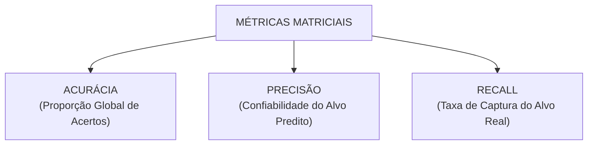

---
aliases:
  - Métricas de Avaliação
  - Acurácia
  - Accuracy
  - Recall
  - Sensibilidade
  - Revocação
  - Precisão
  - Precision
  - F1-Score
  - Matriz de Confusão
  - Curva ROC
  - AUC
  - Especificidade
tags:
  - machine-learning
  - metricas
  - avaliacao
  - estatistica
  - r
---

# Métricas de Avaliação de Modelos

A avaliação criteriosa de modelos preditivos é uma das etapas mais críticas de [[Fundamentos de Ciência de Dados]]. O simples treinamento de um algoritmo de [[Aprendizado de Máquina]] — seja uma [[Regressão Linear]], [[Regressão Logística]] ou [[Árvores de Decisão]] — é insuficiente se não formos capazes de quantificar com rigor matemático sua capacidade de generalização diante de dados inéditos.

Diferentes problemas de negócio impõem custos assimétricos para diferentes naturezas de erro. Por isso, a escolha de métricas adequadas e a análise aprofundada da **Matriz de Confusão** são indispensáveis para evitar armadilhas estatísticas comuns, como a ilusão da acurácia elevada em conjuntos de dados com classes desbalanceadas.

---

## 1. A Matriz de Confusão (*Confusion Matrix*)

A **Matriz de Confusão** é a tabela de contingência fundamental utilizada para inspecionar visualmente e quantificar as predições de um modelo de classificação binária confrontadas com os valores reais observados:

| | **Real Positivo (1)** | **Real Negativo (0)** |
| :--- | :---: | :---: |
| **Predito Positivo (1)** | **Verdadeiro Positivo (TP)**<br>*(Acerto)* | **Falso Positivo (FP)**<br>*(Erro Tipo I / Alarme Falso)* |
| **Predito Negativo (0)** | **Falso Negativo (FN)**<br>*(Erro Tipo II / Omissão)* | **Verdadeiro Negativo (TN)**<br>*(Acerto)* |

### 1.1. Os Quatro Quadrantes Elementares
- **Verdadeiro Positivo ($TP$ — *True Positive*)**: A ocorrência real era da classe positiva ($Y = 1$) e o modelo predisse corretamente como positiva ($\hat{Y} = 1$). Exemplo: um empréstimo viável que foi devidamente aprovado.
- **Falso Positivo ($FP$ — *False Positive*)**: A ocorrência real era da classe negativa ($Y = 0$), mas o modelo predisse erroneamente como positiva ($\hat{Y} = 1$). Também conhecido na inferência estatística como **Erro do Tipo I** ou "falso alarme". Exemplo: conceder crédito a um cliente inadimplente.
- **Verdadeiro Negativo ($TN$ — *True Negative*)**: A ocorrência real era negativa ($Y = 0$) e o modelo predisse corretamente como negativa ($\hat{Y} = 0$). Exemplo: recusar crédito a um tomador inadimplente.
- **Falso Negativo ($FN$ — *False Negative*)**: A ocorrência real era positiva ($Y = 1$), mas o modelo predisse incorretamente como negativa ($\hat{Y} = 0$). Conhecido como **Erro do Tipo II** ou "omissão grave". Exemplo: recusar crédito a um cliente idôneo de alto potencial de lucro.

---

## 2. Métricas de Classificação Baseadas na Matriz de Confusão

A partir das quatro contagens fundamentais ($TP, TN, FP, FN$), deriva-se um conjunto de indicadores matemáticos especializados:



---

### 2.1. Acurácia ($Accuracy$)
A **Acurácia** mede a proporção geral de predições corretas (tanto positivas quanto negativas) em relação ao total absoluto de observações avaliadas:

$$\text{Acurácia} = \frac{TP + TN}{TP + TN + FP + FN}$$

#### O Paradoxo da Acurácia (*Accuracy Paradox*)
> [!CAUTION]
> A acurácia **NUNCA** deve ser utilizada isoladamente em conjuntos de dados desbalanceados!

Considere uma base de transações financeiras com $10.000$ pagamentos, dos quais $9.900$ são legítimos ($99\%$) e apenas $100$ são fraudes ($1\%$). Um classificador trivial e inútil que simplesmente rotule **todas** as transações como legítimas atingirá uma acurácia impressionante de:

$$\text{Acurácia} = \frac{0 + 9900}{10000} = 99,0\%$$

Apesar dos $99\%$ de acurácia aparente, o modelo falhou em detectar **100% das fraudes** ($FN = 100, TP = 0$).

---

### 2.2. Acurácia Balanceada ($Balanced\ Accuracy$)
Para mitigar a distorção do desbalanceamento, a **Acurácia Balanceada** calcula a média aritmética entre as taxas de acerto individuais da classe positiva e da classe negativa:

$$\text{Acurácia Balanceada} = \frac{\text{TPR} + \text{TNR}}{2} = \frac{\frac{TP}{TP + FN} + \frac{TN}{TN + FP}}{2}$$

No exemplo da fraude acima:
$$\text{Acurácia Balanceada} = \frac{\frac{0}{100} + \frac{9900}{9900}}{2} = \frac{0 + 1}{2} = 50,0\%$$
O valor de $50\%$ revela imediatamente a ineficácia do modelo (equivalente a jogar uma moeda).

---

### 2.3. Sensibilidade / Recall / Revocação / Taxa de Verdadeiros Positivos ($TPR$)
O **Recall** (também denominado Sensibilidade ou *True Positive Rate*) mensura a capacidade do modelo de **capturar todas as instâncias positivas reais existentes**:

$$\text{Recall} = \frac{TP}{TP + FN}$$

- **Pergunta de Negócio**: *"De todos os casos que realmente eram positivos no mundo real, quantos por cento o modelo conseguiu encontrar?"*
- **Prioridade Máxima**: Quando o custo de um Falso Negativo ($FN$) é inaceitável (ex: detecção precoce de câncer, fraudes financeiras de alto valor, identificação de peças industriais com trincas críticas).

---

### 2.4. Especificidade / Taxa de Verdadeiros Negativos ($TNR$)
A **Especificidade** mede a taxa de acerto entre as instâncias comprovadamente negativas:

$$\text{Especificidade} = \frac{TN}{TN + FP}$$

- **Pergunta de Negócio**: *"De todos os indivíduos sadios, quantos foram corretamente liberados pelo teste diagnóstico?"*
- A **Taxa de Falsos Positivos** ($FPR$ — *False Positive Rate* ou *Fall-out*) é o complemento da especificidade:
  $$\text{FPR} = 1 - \text{Especificidade} = \frac{FP}{TN + FP}$$

---

### 2.5. Precisão / Valor Preditivo Positivo ($PPV$)
A **Precisão** avalia a confiabilidade das predições positivas feitas pelo modelo:

$$\text{Precisão} = \frac{TP}{TP + FP}$$

- **Pergunta de Negócio**: *"De todas as vezes em que o modelo afirmou com convicção que o caso era positivo, quantos de fato eram corretos?"*
- **Prioridade Máxima**: Quando o custo de um Falso Positivo ($FP$) é intolerável (ex: filtros de spam onde um e-mail legítimo de negócios não pode ser descartado indevidamente; investimentos caros disparados por recomendação automática).

---

### 2.6. F1-Score (Média Harmônica)
O **F1-Score** é o indicador de síntese que unifica Precisão e Recall em uma métrica escalar balanceada. Ele utiliza a **média harmônica** em vez da média aritmética:

$$F_1 = 2 \cdot \frac{\text{Precisão} \cdot \text{Recall}}{\text{Precisão} + \text{Recall}} = \frac{2TP}{2TP + FP + FN}$$

#### Por que a Média Harmônica?
A média aritmética comum disfarça desequilíbrios graves: se um modelo possui Precisão de $1,0$ ($100\%$) e Recall de $0,0$ ($0\%$), sua média aritmética simples seria $0,5$ ($50\%$), transmitindo uma falsa sensação de desempenho mediano. 

A média harmônica é sensível a valores desproporcionais e converge para zero sempre que qualquer uma das duas métricas aproxima-se de zero:

$$F_1 = 2 \cdot \frac{1,0 \cdot 0,0}{1,0 + 0,0} = 0,0$$

---

## 3. O Dilema e Trade-off: Precisão versus Recall

Na prática analítica, é virtualmente impossível maximizar a Precisão e o Recall de forma concomitante. Ao manipular o **limiar de corte de decisão** ($\theta$) de um modelo de [[Regressão Logística]]:

- **Reduzir o Limiar ($\theta \downarrow$)** (ex: de $0,50$ para $0,15$):
  - O modelo torna-se mais agressivo na detecção de positivos;
  - O número de $TP$ cresce e os $FN$ caem $\implies$ **O Recall aumenta**;
  - Concomitantemente, aumentam os alarmes falsos ($FP$) $\implies$ **A Precisão diminui**.
- **Aumentar o Limiar ($\theta \uparrow$)** (ex: de $0,50$ para $0,85$):
  - O modelo torna-se altamente conservador e só emite positivo quando tem certeza matemática quase absoluta;
  - Os alarmes falsos ($FP$) colapsam $\implies$ **A Precisão aumenta**;
  - Muitos positivos sutis passam despercebidos ($FN$ cresce) $\implies$ **O Recall despenca**.

| Cenário | Estratégia de Limiar | Impacto nos Erros | Prioridade Prática |
| :--- | :--- | :--- | :--- |
| **Alto Recall (Sensibilidade)** | **Limiar Baixo** ($\theta \downarrow$)<br>*"Não deixar passar nenhum positivo"* | $TP$ elevado, $FN$ mínimo<br>($FP$ elevado, $TN$ reduzido) | Diagnóstico médico, Detecção de fraudes financeiras |
| **Alta Precisão** | **Limiar Alto** ($\theta \uparrow$)<br>*"Só disparar positivo quando tiver certeza absoluta"* | $TP$ moderado, $FP$ quase zero<br>($FN$ elevado, $TN$ máximo) | Filtros de spam severos, Recomendação de investimentos de alto risco |

---

## 4. A Curva ROC e a Métrica AUC

A **Curva ROC** (*Receiver Operating Characteristic*) foi desenvolvida por engenheiros de radar durante a Segunda Guerra Mundial e tornou-se a ferramenta de avaliação gráfica padrão para classificadores probabilísticos.

### 4.1. Construção Gráfica
A curva plota no plano cartesiano:
- **Eixo Y (Ordenadas)**: Taxa de Verdadeiros Positivos ($\text{TPR} = \text{Recall}$);
- **Eixo X (Abscissas)**: Taxa de Falsos Positivos ($\text{FPR} = 1 - \text{Especificidade}$).

A curva é gerada calculando-se o par $(\text{FPR}, \text{TPR})$ para cada limiar possível de corte $\theta \in [0, 1]$.

### 4.2. Gráfico Interativo da Curva ROC (Plotly)

```plotly
data:
  - x: [0, 0, 0.05, 0.1, 0.2, 0.4, 0.7, 1]
    y: [0, 0.7, 0.85, 0.92, 0.96, 0.98, 0.99, 1]
    type: scatter
    mode: lines+markers
    name: 'Modelo Logístico (AUC = 0.95)'
    line:
      color: '#1f77b4'
      width: 3
  - x: [0, 1]
    y: [0, 1]
    type: scatter
    mode: lines
    name: 'Classificador Aleatório (AUC = 0.50)'
    line:
      dash: dash
      color: '#d62728'
      width: 2
layout:
  title: 'Curva Característica de Operação do Receptor (ROC)'
  xaxis:
    title: 'Taxa de Falsos Positivos (1 - Especificidade)'
    range: [0, 1]
  yaxis:
    title: 'Taxa de Verdadeiros Positivos (Sensibilidade / Recall)'
    range: [0, 1]
  legend:
    x: 0.5
    y: 0.2
```

### 4.3. Área sob a Curva ROC (AUC — Area Under the Curve)
A métrica **AUC** resume a curva ROC em um valor escalar único entre $0$ e $1$:

$$\text{AUC} = \int_{0}^{1} \text{TPR}(\text{FPR}) \, d(\text{FPR})$$

- **$\text{AUC} = 1,0$**: Classificador perfeito. Consegue separar perfeitamente as duas classes sem sobreposição de distribuições.
- **$0,90 \le \text{AUC} < 1,0$**: Desempenho excelente.
- **$0,80 \le \text{AUC} < 0,90$**: Desempenho bom.
- **$0,70 \le \text{AUC} < 0,80$**: Desempenho aceitável.
- **$\text{AUC} = 0,50$**: Classificador puramente aleatório (linha diagonal pontilhada). O modelo não aprendeu qualquer sinal útil.
- **$\text{AUC} < 0,50$**: Pior que o acaso (inverter os rótulos de predição tornará o modelo útil).

A grande vantagem teórica da AUC é que ela é **independente do limiar de corte estático escolhido** e **invariante à prevalência de classes**.

---

## 5. Métricas de Avaliação para Modelos de Regressão

Para problemas de previsão contínua como a [[Regressão Linear]], as métricas avaliam a magnitude dos resíduos ($e_i = Y_i - \hat{Y}_i$):

| Métrica | Expressão Matemática | Características Analíticas |
| :--- | :---: | :--- |
| **Erro Absoluto Médio ($MAE$)** | $\frac{1}{n} \sum_{i=1}^{n} \|Y_i - \hat{Y}_i\|$ | Mede o erro médio na mesma unidade física da variável resposta. Robusto a outliers. |
| **Erro Quadrático Médio ($MSE$)** | $\frac{1}{n} \sum_{i=1}^{n} (Y_i - \hat{Y}_i)^2$ | Penaliza severamente grandes erros devido à elevação quadrática. |
| **Raiz do Erro Quadrático ($RMSE$)** | $\sqrt{\frac{1}{n} \sum_{i=1}^{n} (Y_i - \hat{Y}_i)^2}$ | Mantém a penalidade quadrática, mas retorna o erro à unidade de medida original de $Y$. |
| **Coeficiente $R^2$** | $1 - \frac{\sum (Y_i - \hat{Y}_i)^2}{\sum (Y_i - \bar{Y})^2}$ | Proporção da variância de $Y$ explicada pelo modelo em relação à média simples. |
| **$R^2$ Ajustado ($R^2_{\text{adj}}$)** | $1 - \left[ \frac{(1 - R^2)(n - 1)}{n - k - 1} \right]$ | Penaliza a inclusão desnecessária de preditores redundantes. |

---

## 6. Dilema Viés versus Variância (*Bias-Variance Tradeoff*)

O erro de generalização de qualquer algoritmo de [[Aprendizado de Máquina]] pode ser decomposto matematicamente em três componentes:

$$\text{Erro Esperado} = \text{Viés}^2 + \text{Variância} + \sigma^2_{\text{irredutível}}$$

```plotly
data:
  - x: [1, 2, 3, 4, 5, 6, 7, 8, 9, 10]
    y: [11.2, 8.6, 6.8, 5.8, 5.4, 5.8, 6.8, 8.6, 11.0, 14.1]
    type: scatter
    mode: lines
    name: 'Erro Total de Generalização'
    line:
      color: '#d62728'
      width: 3.5
  - x: [1, 2, 3, 4, 5, 6, 7, 8, 9, 10]
    y: [10.0, 7.2, 5.0, 3.4, 2.2, 1.4, 0.8, 0.4, 0.2, 0.1]
    type: scatter
    mode: lines
    name: 'Viés² (Alto na Esquerda: Subajuste)'
    line:
      color: '#1f77b4'
      dash: dash
      width: 2.5
  - x: [1, 2, 3, 4, 5, 6, 7, 8, 9, 10]
    y: [0.2, 0.4, 0.8, 1.4, 2.2, 3.4, 5.0, 7.2, 9.8, 13.0]
    type: scatter
    mode: lines
    name: 'Variância (Alta na Direita: Sobreajuste)'
    line:
      color: '#ff7f0e'
      dash: dot
      width: 2.5
  - x: [1, 10]
    y: [1.0, 1.0]
    type: scatter
    mode: lines
    name: 'Erro Irredutível (Ruído)'
    line:
      color: '#7f7f7f'
      dash: dashdot
      width: 1.5
  - x: [5]
    y: [5.4]
    type: scatter
    mode: markers
    name: 'Ponto Ótimo de Complexidade'
    marker:
      color: '#2ca02c'
      size: 11
layout:
  title: 'Dilema Viés versus Variância (Bias-Variance Tradeoff)'
  xaxis:
    title: 'Complexidade do Modelo (Graus de Liberdade / Flexibilidade)'
  yaxis:
    title: 'Erro Esperado'
  hovermode: 'closest'
```

- **Subajuste (*Underfitting* — Alto Viés)**:
  - O modelo é excessivamente simples para capturar o padrão real dos dados (ex: ajustar uma reta linear a dados parabólicos).
  - Apresenta alto erro tanto no conjunto de treino quanto no conjunto de validação.
- **Sobreajuste (*Overfitting* — Alta Variância)**:
  - O modelo é excessivamente complexo (ex: [[Árvores de Decisão]] sem poda com dezenas de níveis). Ele memoriza o ruído amostral.
  - Apresenta erro próximo de zero no treino, mas erro extremamente elevado na validação e teste.

---

## 7. Implementação Prática de Avaliação em R

```r
library(caret)
library(ROCR)

# 1. Matriz de Confusão completa e indicadores
matriz <- confusionMatrix(
  data = factor(predicoes_classes), 
  reference = factor(classes_reais), 
  positive = "1"
)
print(matriz)

# Extração programática de métricas
acuracia      <- matriz$overall["Accuracy"]
acuracia_bal  <- matriz$byClass["Balanced Accuracy"]
sensibilidade <- matriz$byClass["Sensitivity"]
especificid   <- matriz$byClass["Specificity"]
precisao      <- matriz$byClass["Pos Pred Value"]
f1            <- matriz$byClass["F1"]

cat("F1-Score obtido:", round(f1, 4), "\n")

# 2. Objeto de predição e Curva ROC com a biblioteca ROCR
pred_obj <- prediction(probabilidades_preditas, classes_reais)
roc_obj  <- performance(pred_obj, measure = "tpr", x.measure = "fpr")
auc_obj  <- performance(pred_obj, measure = "auc")
auc_score <- auc_obj@y.values[[1]]

cat("Área sob a Curva ROC (AUC):", round(auc_score, 4), "\n")
```

A representação gráfica dessas métricas pode ser documentada diretamente em notas analíticas utilizando [[Visualização de Dados com Plotly]].
