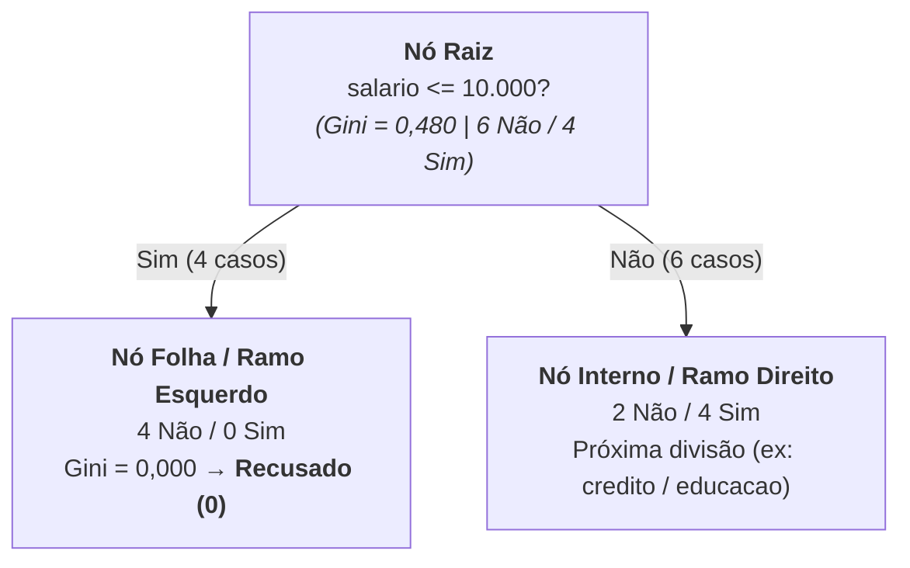

---
aliases:
  - Árvore de Decisão Passo a Passo
  - Guia Passo a Passo Árvore de Decisão
  - Construção de Árvores de Decisão
tags:
  - machine-learning
  - arvores-de-decisao
  - classificacao
  - rpart
  - passo-a-passo
---

# Árvore de Decisão — Guia Passo a Passo

A **Árvore de Decisão** (*Decision Tree*) é uma técnica de [[Aprendizado de Máquina]] supervisionado não paramétrica, utilizada principalmente para classificação (e também para regressão). Ela funciona dividindo o conjunto de dados sucessivamente por meio de regras lógicas do tipo *"se-então"* (*if-then-else*), sendo extremamente útil quando as relações entre os atributos e a variável resposta são **não lineares** ou dependem de **interações complexas** entre variáveis.

> [!INFO] Relação com outras notas do cofre
> Este guia aprofunda o passo a passo matemático e algorítmico do material do curso (`03.1` e `03.2`). Para consulta rápida de fórmulas e códigos de loss matrix, veja também [[Árvores de Decisão]]. Para avançar para múltiplos modelos combinados, acesse [[Floresta Aleatória - Guia Completo]]. Para o estudo de caso completo em R, consulte [[Exercício Resolvido em R - Árvore de Decisão Water Quality]].

---

## 1. Qualidades e Limitações do Algoritmo

Antes de construir uma árvore, é fundamental conhecer quando ela brilha e onde ela falha:

| ✅ Qualidades (Pontos Fortes) | ⚠️ Limitações (Pontos de Atenção) |
| :--- | :--- |
| **Dispensa padronização/normalização**: Apenas a ordem (posto/*rank*) dos valores numéricos importa, não a escala absoluta. | **Propensão ao sobreajuste (*Overfitting*)**: Sem restrições ou poda, a árvore memoriza o ruído do treino. |
| **Robusta a dados perdidos (`NA`s)**: Consegue lidar com valores ausentes durante o particionamento (via divisões substitutas). | **Viés em categóricas com muitos níveis**: Atributos como profissão, cidade ou fabricante criam divisões hiperespecíficas em árvores não binárias. |
| **Alta interpretabilidade**: Permite rastrear exatamente o caminho lógico até qualquer decisão final. | **Instabilidade estrutural**: Pequenas alterações nos dados de treino podem gerar uma árvore completamente diferente (o que motiva a [[Floresta Aleatória - Guia Completo|Floresta Aleatória]]). |
| **Seleção automática de variáveis**: Atributos pouco informativos simplesmente não são escolhidos nas divisões. | **Fronteiras apenas ortogonais**: Como testa uma variável por vez ($X_j \le c$), não cria fronteiras diagonais suaves diretamente. |

---

## 2. Passo 1: Como Medir a Impureza de um Nó

O objetivo da árvore em cada divisão é transformar um conjunto misturado (impuro) de classes em subgrupos o mais homogêneos (puros) possíveis.

Seja $c$ o número de classes e $p_i(t)$ a proporção de observações da classe $i$ no nó $t$:

1. **[[Entropia]] de Shannon**:
   $$\text{Entropia}(t) = - \sum_{i=0}^{c-1} p_i(t) \cdot \log_2 [p_i(t)] \quad \text{(com } 0 \cdot \log_2 0 = 0\text{)}$$
2. **[[Índice Gini]]** *(critério padrão do pacote `rpart` em R)*:
   $$\text{Gini}(t) = 1 - \sum_{i=0}^{c-1} [p_i(t)]^2$$
3. **Erro de Classificação**:
   $$\text{Erro}(t) = 1 - \max_i [p_i(t)]$$

### Comportamento Visual das Três Medidas de Impureza (2 Classes)

O gráfico interativo abaixo mostra como a impureza varia à medida que a proporção da Classe Positiva ($p$) muda de $0\%$ (nó puro) até $50\%$ (mistura máxima) e volta para $100\%$ (nó puro):

```plotly
data:
  - x: [0.0, 0.05, 0.1, 0.167, 0.2, 0.3, 0.333, 0.4, 0.5, 0.6, 0.667, 0.7, 0.8, 0.833, 0.9, 0.95, 1.0]
    y: [0.0, 0.286, 0.469, 0.650, 0.722, 0.881, 0.918, 0.971, 1.000, 0.971, 0.918, 0.881, 0.722, 0.650, 0.469, 0.286, 0.0]
    type: scatter
    mode: lines+markers
    name: 'Entropia de Shannon (Máx = 1.0)'
    line:
      color: '#1f77b4'
      width: 3
  - x: [0.0, 0.05, 0.1, 0.167, 0.2, 0.3, 0.333, 0.4, 0.5, 0.6, 0.667, 0.7, 0.8, 0.833, 0.9, 0.95, 1.0]
    y: [0.0, 0.095, 0.180, 0.278, 0.320, 0.420, 0.444, 0.480, 0.500, 0.480, 0.444, 0.420, 0.320, 0.278, 0.180, 0.095, 0.0]
    type: scatter
    mode: lines+markers
    name: 'Índice Gini (Máx = 0.5)'
    line:
      color: '#2ca02c'
      width: 3
  - x: [0.0, 0.05, 0.1, 0.167, 0.2, 0.3, 0.333, 0.4, 0.5, 0.6, 0.667, 0.7, 0.8, 0.833, 0.9, 0.95, 1.0]
    y: [0.0, 0.05, 0.10, 0.167, 0.20, 0.30, 0.333, 0.40, 0.500, 0.40, 0.333, 0.30, 0.20, 0.167, 0.10, 0.05, 0.0]
    type: scatter
    mode: lines
    name: 'Erro de Classificação (Máx = 0.5)'
    line:
      color: '#ff7f0e'
      dash: dash
      width: 2.5
layout:
  title: 'Curvas de Impureza: Entropia vs Gini vs Erro de Classificação'
  xaxis:
    title: 'Proporção da Classe Positiva no Nó (p)'
  yaxis:
    title: 'Grau de Impureza'
  hovermode: 'closest'
```

> [!TIP] Interpretação Prática do Gráfico
> * **Extremos ($p=0$ ou $p=1$)**: Todas as métricas zeram — o nó é **100% puro**.
> * **Centro ($p=0,5$)**: Impureza máxima — há metade de cada classe no nó.
> * **Por que a Entropia sobe tão rápido?** Mesmo com apenas 1 elemento divergente em 6 ($p=1/6 \approx 0,167$), a Entropia já salta de $0$ para $0,650$, enquanto o Gini vai para $0,278$. Apesar das escalas diferentes, todas são consistentes e apontam para a mesma direção na escolha das variáveis.

---

## 3. Passo 2: Construção da Árvore na Prática (Exemplo do Empréstimo)

Como o algoritmo decide qual pergunta fazer primeiro no **Nó Raiz**? Vamos acompanhar o processo exato usando a amostra de 10 clientes do material do curso (`civil`, `sexo`, `educacao`, `credito`, `salario` $\to$ `emprest`):

No nó raiz, antes de qualquer divisão, temos **6 recusados (`0`) e 4 aprovados (`1`)**. Usando o **Índice Gini**:

$$I(\text{raiz}) = 1 - \left[ \left(\frac{6}{10}\right)^2 + \left(\frac{4}{10}\right)^2 \right] = 1 - (0,36 + 0,16) = \mathbf{0,480}$$

Para avaliar cada variável candidata, calculamos a **Impureza Coletiva dos Nós-Filhos** ($I_{\text{split}}$), que é a média ponderada pelo número de observações que vai para cada ramo:

$$I_{\text{split}} = \frac{n_{\text{esq}}}{N} \cdot I(\text{esq}) + \frac{n_{\text{dir}}}{N} \cdot I(\text{dir})$$

### 3.1. Testando Variáveis Categóricas Binárias (`civil` e `sexo`)
Quando a variável tem apenas 2 níveis, há apenas uma divisão possível:
* **`civil`**: Separa `casado` vs `solteiro` $\implies I_{\text{split}}(\text{civil}) = \mathbf{0,450}$.
* **`sexo`**: Separa `F` vs `M` $\implies I_{\text{split}}(\text{sexo}) = \mathbf{0,467}$.

### 3.2. Testando Variável Categórica com Múltiplos Níveis (`educacao`)
Para 3 categorias (`médio`, `superior`, `pós-graduação`), uma árvore binária testa **1 categoria contra as outras duas agrupadas**:
1. `médio` vs `{superior, pós}`
2. `superior` vs `{médio, pós}`
3. `pós-graduação` vs `{médio, superior}`

Seleciona-se o agrupamento com menor impureza coletiva: $I_{\text{split}}(\text{educacao}) = \mathbf{0,343}$.

### 3.3. Testando Variáveis Numéricas Contínuas (`credito` e `salario`)
Como não é possível criar um ramo para cada número decimal infinito, o algoritmo segue 4 passos:
1. **Ordena** os valores da variável em ordem crescente.
2. **Calcula os pontos médios** entre valores adjacentes como limiares candidatos ($c_m = \frac{x_{(m)} + x_{(m+1)}}{2}$).
3. Para cada corte $c_m$, divide os dados em $X \le c_m$ e $X > c_m$ e calcula a impureza coletiva $I_{\text{split}}$.
4. Escolhe o **melhor corte** daquela variável:
   * Para `credito`, o melhor corte dentre os 11 testados foi `credito <= 8,9`, com $I_{\text{split}} = \mathbf{0,300}$.
   * Para `salario`, o melhor corte foi `salario <= 10.000`, com $I_{\text{split}} = \mathbf{0,267}$.

### 3.4. Escolha da Decisão (O Maior Ganho de Pureza $\Delta$)

Compilando todas as variáveis candidatas frente à impureza original da raiz ($0,480$):

| Variável & Melhor Teste | Impureza Coletiva ($I_{\text{split}}$) | Redução de Impureza ($\Delta = 0,480 - I_{\text{split}}$) | Decisão |
| :--- | :---: | :---: | :---: |
| **`salario <= 10.000`** | **$0,267$** | **$+0,213$** | 🏆 **Escolhida para o Nó Raiz!** |
| `credito <= 8,9` | $0,300$ | $+0,180$ | 2º lugar |
| `educacao` | $0,343$ | $+0,137$ | 3º lugar |
| `civil` | $0,450$ | $+0,030$ | 4º lugar |
| `sexo` | $0,467$ | $+0,013$ | 5º lugar |

O processo então se **repete recursivamente** dentro do ramo esquerdo (`salario <= 10.000`) e do ramo direito (`salario > 10.000`), até atingir nós puros ou um critério de parada!



---

## 4. Passo 3: Divisão dos Dados em Treino, Validação e Teste

Conforme reforçado em [[Pré-Processamento e Engenharia de Atributos]], nunca se treina e avalia uma árvore nos mesmos dados:
* **Treino (~60% a 70%)**: Onde a árvore aprende as regras de corte.
* **Validação (~15% a 20%)**: Onde comparamos versões diferentes da árvore (ex.: completa vs podada vs com pesos) e escolhemos o melhor ponto de poda (`cp`).
* **Teste (~15% a 20%)**: Partição blindada, tocada **apenas uma única vez ao final**, para medir o desempenho real em produção.

---

## 5. Passo 4: Diagnóstico de Overfitting e Pós-Poda (*Pruning*)

Se deixarmos uma árvore crescer livremente (`cp = 0`, `minsplit = 2`), ela criará folhas tão específicas que atingirá quase $100\%$ de acerto no treino, mas errará muito na validação (*[[Métricas de Avaliação de Modelos#6. Dilema Viés versus Variância (Bias-Variance Tradeoff)|Overfitting]]*).

### Como Ler o Gráfico de Poda (`plotcp` / `cptable`)

O R gera uma tabela (`printcp`) e um gráfico (`plotcp`) com os valores do **Parâmetro de Complexidade (`CP`)**, o erro no treino (`rel error`), o erro na validação cruzada (`xerror`) e o desvio-padrão desse erro (`xstd`).

```plotly
data:
  - x: [1, 2, 4, 7, 12, 18]
    y: [1.00, 0.85, 0.72, 0.70, 0.75, 0.84]
    type: scatter
    mode: lines+markers
    name: 'Erro de Validação Cruzada (xerror)'
    line:
      color: '#1f77b4'
      width: 3
    marker:
      size: 9
  - x: [1, 18]
    y: [0.74, 0.74]
    type: scatter
    mode: lines
    name: 'Limiar Regra 1-SE (mín xerror + xstd = 0.70 + 0.04)'
    line:
      color: '#d62728'
      dash: dash
      width: 2
  - x: [4]
    y: [0.72]
    type: scatter
    mode: markers+text
    name: 'Ponto Ótimo de Poda (Árvore Mais Simples abaixo de 1-SE)'
    text: ['Poda Ideal (4 folhas)']
    textposition: 'top right'
    marker:
      color: '#2ca02c'
      size: 13
      symbol: 'star'
layout:
  title: 'Seleção do Parâmetro de Complexidade (CP) via Regra 1-SE'
  xaxis:
    title: 'Tamanho da Árvore (Número de Nós Folha)'
  yaxis:
    title: 'Erro Relativo de Validação Cruzada (xerror)'
```

#### Passo a passo para podar usando a **Regra de 1 Erro-Padrão (1-SE Rule)**:
1. Localize na tabela `printcp` o **menor `xerror`** obtido (no gráfico acima: $0,70$, com 7 folhas).
2. Some o desvio-padrão correspondente (`xstd`, por exemplo $0,04$) ao menor `xerror`: $0,70 + 0,04 = \mathbf{0,74}$ (linha tracejada vermelha).
3. Procure a árvore **mais simples (menor tamanho / mais à esquerda)** cujo `xerror` já esteja **abaixo** desse limite ($0,72 \le 0,74$, com 4 folhas).
4. Pegue o `CP` dessa linha (ou um valor ligeiramente superior para garantir o corte) e aplique `prune(modelo, cp = ...)`.

---

## 6. Passo 5: Pré-Poda e Ajuste Automatizado (`caret`)

Além da pós-poda (`prune`), você pode limitar o crescimento da árvore antes mesmo dela ficar grande (**pré-poda** via `rpart.control`):
* `minsplit`: Mínimo de observações em um nó para tentar dividi-lo (padrão: $20$).
* `minbucket`: Mínimo de observações permitido em qualquer nó folha terminal (padrão: `round(minsplit/3)`).
* `maxdepth`: Profundidade máxima da árvore (padrão: $30$).
* `cp`: Redução mínima exigida no erro relativo para aceitar uma divisão (padrão: $0,01$).

Também é possível testar vários valores de `cp` automaticamente usando validação cruzada via pacote `caret` (`train(..., method = "rpart")`).

---

## 7. Passo 6: Lidando com Classes Desbalanceadas e Custos Assimétricos

Nos estudos de caso práticos da aula (**Fraude no Seguro**, **Banco** e **Sucesso Acadêmico**), quando uma classe é rara (ex: menos de 30% de fraudes) ou quando um erro custa muito mais caro que outro (ex: liberar uma fraude vs investigar um cliente honesto), a árvore padrão tende a ignorar a classe minoritária para maximizar a [[Acurácia]] global.

Para resolver isso, o curso apresenta três estratégias:

1. **Modelo com Pesos (*Weights*)**: Atribui-se peso maior às observações da classe minoritária (inversamente proporcional à frequência de cada classe):
   $$\text{Peso}_{\text{Positivo}} = \frac{N_{\text{Negativos}}}{N_{\text{Total}}}, \qquad \text{Peso}_{\text{Negativo}} = \frac{N_{\text{Positivos}}}{N_{\text{Total}}}$$
2. **Modelo com Matriz de Perda / Custo (*Loss Matrix*)**: Passada ao parâmetro `parms = list(loss = matriz)` no `rpart`, penalizando mais severamente Falsos Negativos ($FN$) do que Falsos Positivos ($FP$), o que eleva o [[Recall]] e a **Acurácia Balanceada**.
3. **Subamostragem / Sobreamostragem (*Downsampling / Upsampling*)**: Equilibrar a proporção de classes no conjunto de treino antes de induzir a árvore (mantendo validação e teste com a proporção real original).
